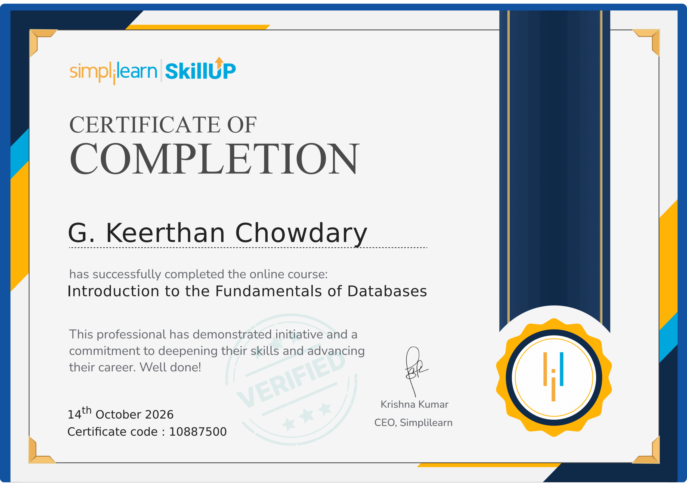
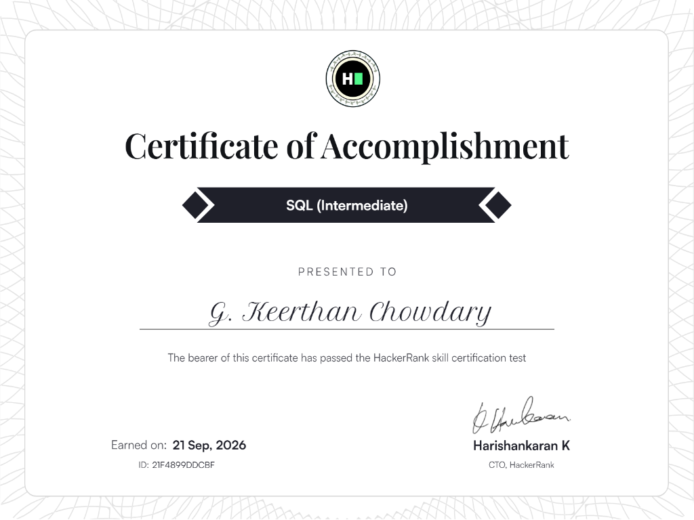
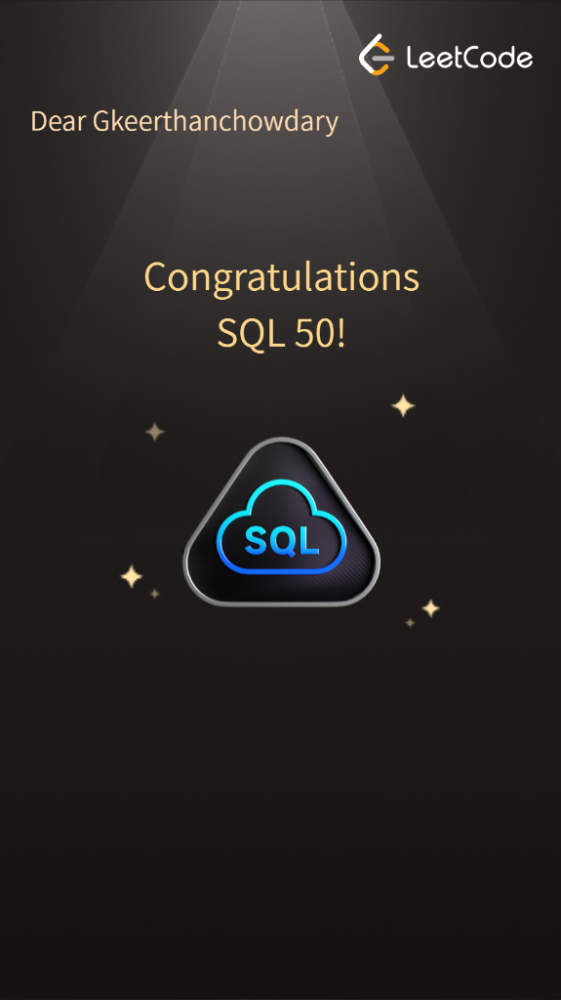

# Professional Database & SQL Certifications

> **Author:** G. Keerthan Chowdary (**Roll No:** `25WU0102076` | **Email:** `keerthan.g_2029@woxsen.edu.in`)  
> **Institution:** School of Technology, Woxsen University  
> **Program:** B.Tech Computer Science & Engineering (AI & ML) — Batch 2025 – 2029  
> **Course:** Database Management Systems (DBMS)  

📄 **[Click here to view the PDF version directly in GitHub](Certificates.pdf)** *(Renders natively in GitHub's interactive PDF document viewer)*

---

## 📑 Certifications & Skill Badges Overview

| # | Credential Title | Issuing Organization | Issue Date | Credential ID / Verification |
| :-: | :--- | :--- | :--- | :--- |
| **1** | **Introduction to the Fundamentals of Databases** | **Simplilearn SkillUp** | 14th October 2026 | Certificate Code: `10887500` |
| **2** | **SQL (Intermediate) Certificate of Accomplishment** | **HackerRank** | 21st September 2026 | Certificate ID: `21F4899DDCBF` |
| **3** | **SQL 50 Study Plan Completion** | **LeetCode** | October 2026 | Profile: `Gkeerthanchowdary` |

---

## 1. Simplilearn SkillUp: Introduction to the Fundamentals of Databases

### Credential Details
- **Recipient:** G. Keerthan Chowdary
- **Issuer:** Simplilearn SkillUp
- **Certificate Name:** Certificate of Completion — Introduction to the Fundamentals of Databases
- **Issue Date:** 14th October 2026
- **Certificate Code:** `10887500`
- **Authorized Signatory:** Krishna Kumar, CEO, Simplilearn
- **Competencies Mastered:**
  - Relational Database Management Systems (RDBMS) architecture.
  - Database schema definition, primary/foreign keys, and declarative integrity constraints.
  - Structured Query Language (SQL) data manipulation, filtering, and table relationships.
  - Normalization concepts ensuring data consistency and elimination of redundancies.

---

## 2. HackerRank: SQL (Intermediate) Skill Certification

### Credential Details
- **Recipient:** G. Keerthan Chowdary
- **Issuer:** HackerRank
- **Certificate Name:** Certificate of Accomplishment — SQL (Intermediate)
- **Earned on:** 21st September 2026
- **Certificate ID:** `21F4899DDCBF`
- **Authorized Signatory:** Harishankaran K, CTO, HackerRank
- **Competencies Mastered:**
  - Advanced multi-table `JOIN` operations (Inner, Left, Right, Self-joins).
  - Correlated and nested subqueries with aggregation and filtering.
  - `GROUP BY`, `HAVING`, window functions, and analytical calculations.
  - Complex constraint validation and transactional query logic.

---

## 3. LeetCode: SQL 50 Study Plan Completion

  

### Credential Details
- **Recipient:** Gkeerthanchowdary (G. Keerthan Chowdary)
- **Issuer:** LeetCode
- **Achievement:** Congratulations SQL 50! Study Plan Milestone
- **Curriculum Scope (50 Curated Industrial SQL Challenges):**
  - **Select & Filtering:** Primary key extraction, conditional predicates, and null-value handling.
  - **Basic & Advanced Joins:** Managing complex many-to-many relationships and relational integrity.
  - **Aggregate Functions:** Dynamic aggregations, conditional counting, and revenue calculations.
  - **Sorting & Grouping:** Multi-level ordering, rank partitioning, and statistical groupings.
  - **Advanced String & Regex Functions:** Text parsing, pattern matching, and formatted outputs.

---
*End of Professional Certifications Deliverable*
