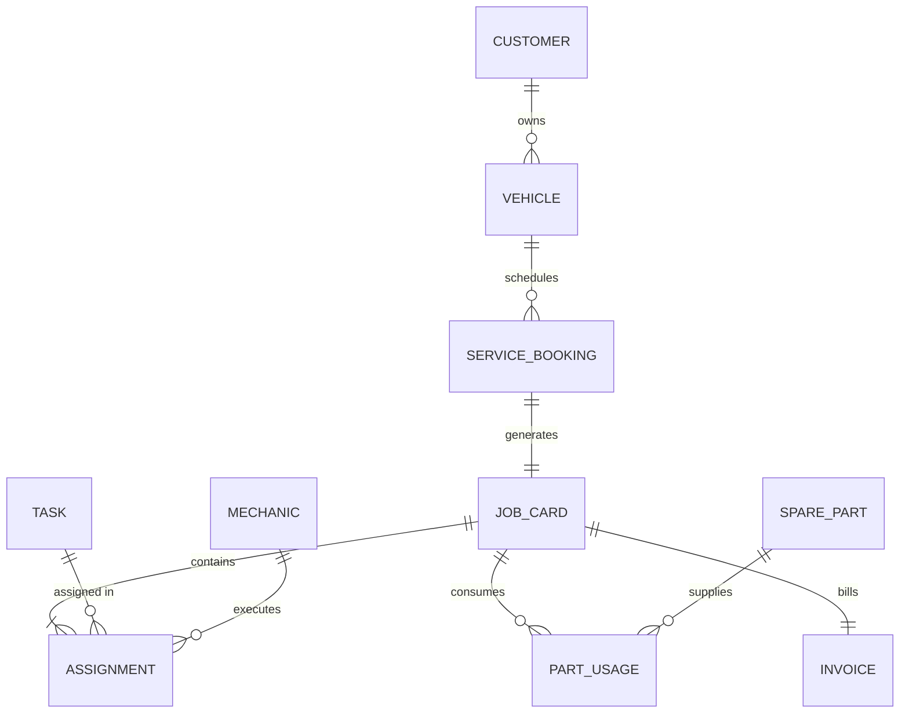

# Project-Based Learning (PBL) Report: Vehicle Service Centre Management System

> **WOXSEN UNIVERSITY — SCHOOL OF TECHNOLOGY**  
> **Course & Code:** Database Management Systems (DBMS)  
> **Project Title:** DESIGN AND IMPLEMENTATION OF A DATABASE MANAGEMENT SYSTEM FOR VEHICLE SERVICE CENTRE MANAGEMENT  
> **Program:** B.Tech in Computer Science and Engineering (AI & ML) — Section: AIML Rhinos  
> **Batch:** 2025 – 2029 | Academic Year: 2026 – 2027  
> **Course Faculty:** Prof. Sahithi, School of Technology  
> **Submitted by:** G. Keerthan Chowdary (Roll No: `25WU0102076` | Email: `keerthan.g_2029@woxsen.edu.in`)  
> **Date of Submission:** October 2026  

📄 **[Click here to view the PDF Report directly in GitHub](Project-Report.pdf)**

---

## Acknowledgement & Undertaking

### Acknowledgement
I express my sincere gratitude to Woxsen University, School of Technology, for giving me the opportunity to undertake this Project-Based Learning (PBL) activity as part of the Database Management Systems (DBMS) course.

I express my heartfelt thanks to my course faculty, **Prof. Sahithi**, for continuous guidance, constructive suggestions and support throughout the design and development of this project. The guidance helped me understand the practical use of core relational database concepts, including Entity-Relationship (ER) modelling, relational schema design, functional dependencies, normalization up to Third Normal Form (3NF), SQL constraint definition, triggers, querying, transaction management and database application development using Python.

This PBL activity has strengthened my understanding of database design and transactional integrity, and gave me hands-on experience in building a practical solution for the day-to-day operations of a vehicle service centre.

### Undertaking
I hereby declare that the project entitled **"DESIGN AND IMPLEMENTATION OF A DATABASE MANAGEMENT SYSTEM FOR VEHICLE SERVICE CENTRE MANAGEMENT"**, submitted as part of the Project-Based Learning activity for the Database Management Systems (DBMS) course, is my individual work carried out under the guidance of my course faculty, Prof. Sahithi.

I undertake that the project report, database design, SQL scripts, application source code, results and supporting materials submitted by me have been prepared for academic purposes. Wherever information, ideas, tools, datasets or other resources have been referred to, appropriate acknowledgement has been provided.

I further undertake that I am responsible for the correctness and authenticity of the work submitted and that I have followed the academic and project guidelines prescribed by the University.

- **Date:** October 05, 2026  
- **Place:** Hyderabad, Telangana  
- **Name:** G. Keerthan Chowdary (`25WU0102076`)  
- **Program:** B.Tech CSE (AI & ML) - AIML Rhinos, Woxsen University  

---

## Abstract & Keywords

### Abstract
Vehicle service centres handle a continuous flow of customers, vehicles, repair tasks, mechanics, spare parts and invoices. When these are recorded on paper job cards, registers and isolated spreadsheets, repair history is lost, mechanics are scheduled into conflicting time slots, spare parts run out unnoticed, and invoices contain avoidable errors. The objective of this project is to design, normalize and implement a Relational Database Management System (RDBMS) for a multi-brand vehicle service centre.

The conceptual model contains ten interrelated entities: customers, vehicles, service bookings, job cards, mechanics, tasks, assignments, spare parts, part usage and invoices. The design is normalized to Third Normal Form (3NF) to remove redundancy and update anomalies. Critical business rules, namely one active booking per vehicle slot, one job card per booking, no overlapping mechanic assignments, no issue of parts beyond available stock, positive quantities and one invoice per job card, are enforced through declarative constraints and triggers. A Python application built on the standard sqlite3 interface supports registration, booking, check-in, task scheduling, parts issue with automatic stock deduction, invoice generation with GST, and operational reports. A test suite of fifteen cases, including negative integrity tests, was executed and all cases behaved as specified.

**Keywords:** Relational Database, ER Diagram, Normalization, SQL, Python, Vehicle Service Centre, Triggers, Integrity Constraints.

---

## List of Acronyms

| Acronym | Expansion |
| :--- | :--- |
| **1NF** | First Normal Form |
| **2NF** | Second Normal Form |
| **3NF** | Third Normal Form |
| **ACID** | Atomicity, Consistency, Isolation, Durability |
| **BCNF** | Boyce-Codd Normal Form |
| **CLI** | Command Line Interface |
| **CRUD** | Create, Read, Update, Delete |
| **DBMS** | Database Management System |
| **DDL** | Data Definition Language |
| **DML** | Data Manipulation Language |
| **ERD** | Entity-Relationship Diagram |
| **FK** | Foreign Key |
| **GST** | Goods and Services Tax |
| **PK** | Primary Key |
| **RDBMS** | Relational Database Management System |
| **SQL** | Structured Query Language |

---

## Chapter 1: Problem Statement, Solution Strategy and ER Diagram

### 1.1 Problem Statement
Multi-brand vehicle service centres run many jobs in parallel: customers book slots, vehicles are checked in, mechanics with different specializations work on repair tasks, spare parts are drawn from a shared store, and a final invoice is raised when the job is complete. In many workshops this information still lives on paper job cards, physical registers and separate spreadsheets. Nothing links a customer to a vehicle, a vehicle to its repair history, or a repair to the parts and labor consumed.

This fragmentation causes several recurring problems:
1. Repair progress is hard to track, so history is misplaced and customers are not kept informed.
2. Without automated schedule management, workshop heads cannot assign mechanics by availability, and two jobs are allocated to the same mechanic in the same time slot, which delays deliveries.
3. Spare parts are issued without updating stock, causing unexpected stock-outs and incorrect invoices.
4. Billing depends on manually adding labor and parts, so totals are error-prone and past prices cannot be verified.

There is therefore a clear need for a centralized, normalized relational database that enforces integrity rules, keeps inventory accurate and automates billing.

### 1.2 Objectives
The primary objectives of this project are:
- Design a conceptual Entity-Relationship (ER) model covering the ten core entities of a vehicle service centre, with precise cardinalities.
- Derive the relational schema and normalize it to Third Normal Form (3NF) using functional dependencies, removing insertion, deletion and update anomalies.
- Implement DDL constraints and triggers that enforce key business rules: no duplicate slot bookings, one job card per booking, no overlapping mechanic assignments, no issue of parts beyond stock, and positive quantities.
- Develop SQL queries and reports for low stock, mechanic workload, unpaid invoices, monthly revenue and job card status.
- Build a Python application, connected through the standard database driver, that supports the complete workflow from registration to invoice with clear error handling.

### 1.3 Scope and Assumptions

#### Table 1. Scope and Assumptions
| Item | Description |
| :--- | :--- |
| **In Scope** | Customer and vehicle registration; service slot booking; check-in and job card creation; mechanic and task catalogs; task assignment with overlap prevention; spare parts catalog and stock tracking; parts issue to job cards; invoice generation with labor, parts and 18% GST; payment status; operational reports. |
| **Out of Scope** | Online customer portal; live payment gateway; SMS or email notifications; vehicle diagnostics hardware integration; multi-branch consolidation; user authentication and role-based login. |
| **Assumptions** | Each booking is for one vehicle in one slot; a booking produces at most one job card; labor is charged at the flat rate of each task assigned; parts are billed at the unit price in force when issued; GST is fixed at 18%; one invoice is raised per job card. |

### 1.4 Proposed Solution Strategy

#### Table 2. Proposed Solution Strategy
| Solution Element | Project-Specific Description |
| :--- | :--- |
| **Primary Users / Roles** | Service Advisor, Service Mechanic, Inventory Controller and Workshop Manager. |
| **Major Application Modules** | Customer and Vehicle Registration; Booking and Job Card Management; Mechanic Scheduling; Parts and Inventory; Billing; Reports. |
| **Proposed Workflow** | Advisor registers customer/vehicle and books slot $\rightarrow$ vehicle check-in opens job card $\rightarrow$ non-overlapping mechanic task assignment $\rightarrow$ parts issued from stock $\rightarrow$ invoice computed with GST $\rightarrow$ job closed and payment recorded. |
| **Important Business Rules** | 1 booking per vehicle/date/slot; 1 job card per booking; zero mechanic overlap; no negative stock; positive prices and quantities; 1 invoice per job card. |
| **Expected Reports** | Job card status; low-stock parts; mechanic workload in hours; unpaid invoices with customer names; monthly revenue. |

### 1.5 Functional Requirements

#### Table 3. Functional Requirements
| Req. ID | Functional Requirement | Remarks / Priority |
| :---: | :--- | :--- |
| **FR-01** | Store customer profiles and vehicles registered to each customer. | High / Core Master Data |
| **FR-02** | Record service bookings with date/slot and reject duplicates for same vehicle/slot. | High / Integrity Rule |
| **FR-03** | Open exactly one job card for a booking upon vehicle check-in. | High / Core Workflow |
| **FR-04** | Maintain mechanic and repair task catalogs, with specializations and labor rates. | Medium / Master Data |
| **FR-05** | Assign tasks to mechanics with start/end times and reject overlapping slots. | High / Critical Integrity Rule |
| **FR-06** | Maintain spare parts catalog with unit price, stock quantity and reorder level. | High / Master Data |
| **FR-07** | Issue parts to job cards, verify stock, deduct automatically and record billed price. | High / Inventory Integrity |
| **FR-08** | Generate one invoice per job card summing labor and parts totals plus 18% GST. | High / Financial Accuracy |
| **FR-09** | Close job card, complete booking and record payment status upon billing. | Medium / Workflow |
| **FR-10** | Provide operational reports for job cards, low stock, workload, unpaid bills, revenue. | High / Business Analytics |

### 1.6 Entity-Relationship Diagram (ERD)

### 1.7 Entity and Relationship Summary

#### Table 4. Entity and Relationship Summary
| Entity / Relationship | Major Attributes / Cardinality | Purpose / Rule |
| :--- | :--- | :--- |
| **CUSTOMER** | `CustomerID` (PK), Name, Phone, Email, Address | Customer master; Phone and Email are unique. |
| **VEHICLE** | `RegNo` (PK), CustomerID (FK), Make, Model, MfgYear, FuelType (`1:N` with CUSTOMER) | Registered vehicles; year and fuel type are validated. |
| **SERVICE_BOOKING** | `BookingID` (PK), RegNo (FK), BookingDate, SlotTime, Status (`1:N` with VEHICLE) | Slot reservation; `UNIQUE(RegNo, BookingDate, SlotTime)`. |
| **JOB_CARD** | `JobCardID` (PK), BookingID (FK), DateIn, DateOut, JobStatus (`1:1` with SERVICE_BOOKING) | Work order opened at check-in; `DateOut >= DateIn`. |
| **MECHANIC** | `MechanicID` (PK), Name, Specialization, Phone | Workshop staff master; Phone is unique. |
| **TASK** | `TaskID` (PK), TaskName, LaborRate | Catalog of repair tasks; `LaborRate >= 0`. |
| **ASSIGNMENT** | `AssignmentID` (PK), JobCardID, TaskID, MechanicID (FKs), StartTime, EndTime, Status (`M:N`) | Associative entity; `EndTime > StartTime`; overlap trigger. |
| **SPARE_PART** | `PartID` (PK), PartName, UnitPrice, StockQty, ReorderLevel | Inventory master; `UnitPrice > 0`, `StockQty >= 0`. |
| **PART_USAGE** | `UsageID` (PK), JobCardID (FK), PartID (FK), Quantity, BilledUnitPrice (`M:N`) | Parts issued; `Quantity > 0`; stock check and deduction trigger. |
| **INVOICE** | `InvoiceID` (PK), JobCardID (FK), LaborTotal, PartsTotal, NetAmount, PaymentStatus (`1:1`) | Final bill; exactly one invoice per job card. |

---

## Chapter 2: Logical Database Design

### 2.1 Relational Schema

#### Table 5. Relational Schema
| S.No. | Table Name | Purpose |
| :---: | :--- | :--- |
| 1 | **Customer** | Stores customer profiles and contact details. |
| 2 | **Vehicle** | Stores vehicles registered to customers, with make, model, year and fuel type. |
| 3 | **Service_Booking** | Stores service slot reservations for vehicles. |
| 4 | **Job_Card** | Stores the work order opened when a booked vehicle is checked in. |
| 5 | **Mechanic** | Stores workshop mechanics and their specializations. |
| 6 | **Task** | Stores the catalog of repair tasks and labor rates. |
| 7 | **Assignment** | Associative relation linking job cards, tasks and mechanics with working times. |
| 8 | **Spare_Part** | Stores spare parts with price, stock quantity and reorder level. |
| 9 | **Part_Usage** | Associative relation recording parts issued to job cards with the price billed. |
| 10 | **Invoice** | Stores the final bill for a job card with labor, parts and net amounts. |

### 2.2 Keys and Integrity Constraints

#### Table 6. Keys and Integrity Constraints
| Table Name | Key / Constraint | Attribute(s) | Business Rule Enforced |
| :--- | :--- | :--- | :--- |
| **Customer** | PK / UNIQUE / NOT NULL | CustomerID / Phone, Email / Name | Unique customer identity; unique phone and email. |
| **Vehicle** | PK / FK / CHECK | RegNo / CustomerID / MfgYear, FuelType | Valid owner; year 1990-2030; fuel in Petrol, Diesel, CNG, Electric. |
| **Service_Booking** | PK / FK / UNIQUE / CHECK | BookingID / RegNo / (RegNo, BookingDate, SlotTime) / Status | No duplicate vehicle slot; status in Booked, Checked-In, Completed, Cancelled. |
| **Job_Card** | PK / FK / UNIQUE / CHECK | JobCardID / BookingID / BookingID / DateOut, JobStatus | 1:1 with booking; DateOut >= DateIn; status in Open, In Progress, Closed. |
| **Mechanic** | PK / UNIQUE / NOT NULL | MechanicID / Phone / Name | Unique mechanic phone; mandatory name. |
| **Task** | PK / UNIQUE / CHECK | TaskID / TaskName / LaborRate | Unique task name; non-negative labor rate. |
| **Assignment** | PK / FK / CHECK / Trigger | AssignmentID / JobCardID, TaskID, MechanicID / EndTime / trg_no_overlap | EndTime > StartTime; mechanic cannot hold overlapping slots. |
| **Spare_Part** | PK / UNIQUE / CHECK | PartID / PartName / UnitPrice, StockQty | Unique part name; price > 0; stock >= 0. |
| **Part_Usage** | PK / FK / CHECK / Triggers | UsageID / JobCardID, PartID / Quantity / trg_check_stock, trg_deduct_stock | Quantity > 0; parts cannot exceed stock; stock reduced after issue. |
| **Invoice** | PK / FK / UNIQUE | InvoiceID / JobCardID / JobCardID | Exactly one invoice per job card. |

### 2.3 Functional Dependencies
- **Customer:** `CustomerID` $\rightarrow$ {Name, Phone, Email, Address}; `Phone` $\rightarrow$ {CustomerID, Name, Email, Address}; `Email` $\rightarrow$ {CustomerID, Name, Phone, Address}.
- **Vehicle:** `RegNo` $\rightarrow$ {CustomerID, Make, Model, MfgYear, FuelType}.
- **Service_Booking:** `BookingID` $\rightarrow$ {RegNo, BookingDate, SlotTime, Status}; {RegNo, BookingDate, SlotTime} $\rightarrow$ {BookingID, Status}.
- **Job_Card:** `JobCardID` $\rightarrow$ {BookingID, DateIn, DateOut, JobStatus}; `BookingID` $\rightarrow$ {JobCardID, DateIn, DateOut, JobStatus}.
- **Mechanic:** `MechanicID` $\rightarrow$ {Name, Specialization, Phone}; `Phone` $\rightarrow$ {MechanicID, Name, Specialization}.
- **Task:** `TaskID` $\rightarrow$ {TaskName, LaborRate}; `TaskName` $\rightarrow$ {TaskID, LaborRate}.
- **Assignment:** `AssignmentID` $\rightarrow$ {JobCardID, TaskID, MechanicID, StartTime, EndTime, Status}.
- **Spare_Part:** `PartID` $\rightarrow$ {PartName, UnitPrice, StockQty, ReorderLevel}; `PartName` $\rightarrow$ {PartID, UnitPrice, StockQty, ReorderLevel}.
- **Part_Usage:** `UsageID` $\rightarrow$ {JobCardID, PartID, Quantity, BilledUnitPrice}.
- **Invoice:** `InvoiceID` $\rightarrow$ {JobCardID, LaborTotal, PartsTotal, NetAmount, PaymentStatus}; `JobCardID` $\rightarrow$ {InvoiceID, LaborTotal, PartsTotal, NetAmount, PaymentStatus}.

### 2.4 Normalization up to Third Normal Form (3NF)
- **1NF:** All attributes hold atomic values and no repeating groups exist.
- **2NF:** Relations are in 1NF and no non-prime attribute depends on a proper subset of a composite candidate key.
- **3NF:** Relations are in 2NF and no non-prime attribute transitively depends on a candidate key.
- **BCNF:** For every non-trivial FD $X \rightarrow Y$, $X$ is a superkey. All ten relations satisfy BCNF.

#### Table 7. Normalization Status up to 3NF
| Relation Name | 1NF | 2NF | 3NF | BCNF | Remarks / Decomposition |
| :--- | :---: | :---: | :---: | :---: | :--- |
| **Customer** | Yes | Yes | Yes | Yes | Candidate keys: CustomerID, Phone, Email. |
| **Vehicle** | Yes | Yes | Yes | Yes | Owner details kept in Customer; only CustomerID stored. |
| **Service_Booking** | Yes | Yes | Yes | Yes | Slot attributes form candidate key; vehicle/owner data not repeated. |
| **Job_Card** | Yes | Yes | Yes | Yes | 1:1 with booking; BookingID is candidate key. |
| **Mechanic** | Yes | Yes | Yes | Yes | Candidate keys: MechanicID, Phone. |
| **Task** | Yes | Yes | Yes | Yes | Labor rate depends only on TaskID. |
| **Assignment** | Yes | Yes | Yes | Yes | Resolves M:N between job cards, tasks and mechanics. |
| **Spare_Part** | Yes | Yes | Yes | Yes | Price and stock depend only on PartID. |
| **Part_Usage** | Yes | Yes | Yes | Yes | Resolves M:N; BilledUnitPrice is a historical snapshot. |
| **Invoice** | Yes | Yes | Yes* | Yes* | *NetAmount is stored deliberately as an immutable billing snapshot. |

### 2.5 Data Dictionary

#### Table 8. Comprehensive Data Dictionary
| Table | Attribute | Data Type | Key / Constraint | Description |
| :--- | :--- | :--- | :--- | :--- |
| **Customer** | CustomerID | INTEGER | PK, AUTOINCREMENT | Unique customer identifier. |
| | Name | TEXT | NOT NULL | Customer full name. |
| | Phone | TEXT | NOT NULL, UNIQUE | Primary contact number. |
| | Email | TEXT | UNIQUE | Contact email address. |
| | Address | TEXT | - | Residential or billing address. |
| **Vehicle** | RegNo | TEXT | PK | Vehicle registration number. |
| | CustomerID | INTEGER | FK, NOT NULL | Owner; ON DELETE CASCADE. |
| | Make | TEXT | NOT NULL | Manufacturer name. |
| | Model | TEXT | NOT NULL | Model name. |
| | MfgYear | INTEGER | CHECK 1990 to 2030 | Year of manufacture. |
| | FuelType | TEXT | CHECK IN list | Petrol, Diesel, CNG or Electric. |
| **Service_Booking** | BookingID | INTEGER | PK, AUTOINCREMENT | Unique booking identifier. |
| | RegNo | TEXT | FK, NOT NULL | Vehicle being booked. |
| | BookingDate | TEXT | NOT NULL | Date of the service slot. |
| | SlotTime | TEXT | NOT NULL | Time of the service slot. |
| | Status | TEXT | DEFAULT 'Booked', CHECK | Booked, Checked-In, Completed or Cancelled. |
| **Job_Card** | JobCardID | INTEGER | PK, AUTOINCREMENT | Unique job card identifier. |
| | BookingID | INTEGER | FK, NOT NULL, UNIQUE | Booking this job card belongs to. |
| | DateIn | TEXT | NOT NULL | Date the vehicle was checked in. |
| | DateOut | TEXT | CHECK >= DateIn | Date the job was closed. |
| | JobStatus | TEXT | DEFAULT 'Open', CHECK | Open, In Progress or Closed. |
| **Mechanic** | MechanicID | INTEGER | PK, AUTOINCREMENT | Unique mechanic identifier. |
| | Name | TEXT | NOT NULL | Mechanic full name. |
| | Specialization | TEXT | - | Area of expertise. |
| | Phone | TEXT | UNIQUE | Contact number. |
| **Task** | TaskID | INTEGER | PK, AUTOINCREMENT | Unique task identifier. |
| | TaskName | TEXT | NOT NULL, UNIQUE | Name of the repair task. |
| | LaborRate | REAL | CHECK >= 0 | Labor charge for the task. |
| **Assignment** | AssignmentID | INTEGER | PK, AUTOINCREMENT | Unique assignment identifier. |
| | JobCardID | INTEGER | FK, NOT NULL | Job card the task belongs to. |
| | TaskID | INTEGER | FK, NOT NULL | Task to be performed. |
| | MechanicID | INTEGER | FK, NOT NULL | Mechanic performing the task. |
| | StartTime | TEXT | NOT NULL | Scheduled start date and time. |
| | EndTime | TEXT | CHECK > StartTime | Scheduled end date and time. |
| | Status | TEXT | DEFAULT 'Assigned' | Progress of the task. |
| **Spare_Part** | PartID | INTEGER | PK, AUTOINCREMENT | Unique part identifier. |
| | PartName | TEXT | NOT NULL, UNIQUE | Name of the spare part. |
| | UnitPrice | REAL | CHECK > 0 | Current selling price per unit. |
| | StockQty | INTEGER | NOT NULL, DEFAULT 0, CHECK >= 0 | Units currently in stock. |
| | ReorderLevel | INTEGER | DEFAULT 5 | Stock level that triggers reordering. |
| **Part_Usage** | UsageID | INTEGER | PK, AUTOINCREMENT | Unique usage identifier. |
| | JobCardID | INTEGER | FK, NOT NULL | Job card the part was issued to. |
| | PartID | INTEGER | FK, NOT NULL | Part issued. |
| | Quantity | INTEGER | NOT NULL, CHECK > 0 | Units issued. |
| | BilledUnitPrice | REAL | NOT NULL | Unit price locked at the time of issue. |
| **Invoice** | InvoiceID | INTEGER | PK, AUTOINCREMENT | Unique invoice identifier. |
| | JobCardID | INTEGER | FK, NOT NULL, UNIQUE | Job card being billed. |
| | LaborTotal | REAL | DEFAULT 0 | Sum of task labor charges. |
| | PartsTotal | REAL | DEFAULT 0 | Sum of quantity x billed price. |
| | NetAmount | REAL | DEFAULT 0 | (Labor + parts) plus 18% GST. |
| | PaymentStatus | TEXT | DEFAULT 'Unpaid' | Unpaid or Paid. |

---

## Chapter 3: Application Development & Testing

### 3.1 Architecture & Implementation Environment
- **DBMS Engine:** SQLite 3 with strict foreign key validation (`PRAGMA foreign_keys = ON;`).
- **Web Interface:** Python 3 + Flask with responsive Bootstrap 5 and interactive Chart.js dashboards.
- **Terminal Prototype:** Standalone interactive menu application (`service_centre.py`).

### 3.2 Testing & Results Verification

#### Table 15. Test Cases and Verification Outcomes
| ID | Feature | Input / Action | Expected Result | Actual Result | Status |
| :---: | :--- | :--- | :--- | :--- | :---: |
| **TC-01** | Vehicle registration | Register TS09AB1234 (Honda City, Petrol) | Row inserted | Vehicle TS09AB1234 registered | **PASSED** |
| **TC-02** | Unique phone (negative) | Register 2nd customer with phone 9876543210 | UNIQUE constraint rejects | UNIQUE constraint failed: Customer.Phone | **PASSED** |
| **TC-03** | Fuel type check (negative) | Insert vehicle with FuelType = 'Steam' | CHECK constraint rejects | CHECK constraint failed: FuelType IN (...) | **PASSED** |
| **TC-04** | Referential integrity (negative) | Insert vehicle for non-existent customer 99 | Foreign key rejects | FOREIGN KEY constraint failed | **PASSED** |
| **TC-05** | Duplicate booking (negative) | Book TS09AB1234 again for 2026-10-12 10:00 | UNIQUE rejects row | UNIQUE constraint failed: Service_Booking | **PASSED** |
| **TC-06** | One job card per booking | Open second job card for booking 1 | UNIQUE rejects row | UNIQUE constraint failed: Job_Card.BookingID | **PASSED** |
| **TC-07** | Task time order (negative) | Assign task with EndTime < StartTime | CHECK rejects row | CHECK constraint failed: EndTime > StartTime | **PASSED** |
| **TC-08** | Mechanic overlap (negative) | Assign mechanic to 10:30-11:30 (overlaps) | Trigger aborts insert | Mechanic already booked in that time slot | **PASSED** |
| **TC-09** | Mechanic scheduling | Assign mechanic to 11:00-12:00 (no overlap) | Row inserted | Assignment inserted | **PASSED** |
| **TC-10** | Out-of-stock part (negative) | Issue 5 Brake Pad Sets (stock = 3) | Trigger aborts insert | Insufficient stock | **PASSED** |
| **TC-11** | Positive quantity (negative) | Issue part with Quantity = -2 | CHECK rejects row | CHECK constraint failed: Quantity > 0 | **PASSED** |
| **TC-12** | Stock deduction | Issue 4 Engine Oil and 1 Brake Pad Set | Stock drops (40->36, 3->2) | Stock updated dynamically via trigger | **PASSED** |
| **TC-13** | Invoice calculation | Generate invoice for job card 1 | `(1100 + 3600) * 1.18 = 5546` | Labor 1100, Parts 3600, Net 5546.00 | **PASSED** |
| **TC-14** | Duplicate invoice (negative) | Insert second invoice for job card 1 | UNIQUE rejects row | UNIQUE constraint failed: Invoice.JobCardID | **PASSED** |
| **TC-15** | Date order on job card | Update DateOut earlier than DateIn | CHECK rejects update | CHECK constraint failed: DateOut >= DateIn | **PASSED** |

---

## Chapter 4: Conclusion & References

This Project-Based Learning activity completed the design, normalization, implementation and application development of a Vehicle Service Centre Management System. Ten entities were derived from the requirements, modelled in an ER diagram and normalized to Third Normal Form. The key business rules—namely single booking per slot, one job card per booking, no overlapping mechanic assignments, no issue of parts beyond stock and one invoice per job card—are enforced inside the database through constraints and triggers. Both a responsive web application and an automated CLI prototype deliver the complete lifecycle workflow from registration to billing.

### References
1. A. Silberschatz, H. F. Korth, and S. Sudarshan, *Database System Concepts*, 7th ed. McGraw-Hill Education, 2020.
2. R. Elmasri and S. B. Navathe, *Fundamentals of Database Systems*, 7th ed. Pearson, 2016.
3. C. J. Date, *An Introduction to Database Systems*, 8th ed. Addison-Wesley, 2004.
4. J. D. Ullman and J. Widom, *A First Course in Database Systems*, 3rd ed. Prentice Hall, 2008.
5. SQLite Development Team, *"SQLite Documentation,"* SQLite.org. Available: https://www.sqlite.org/docs.html
