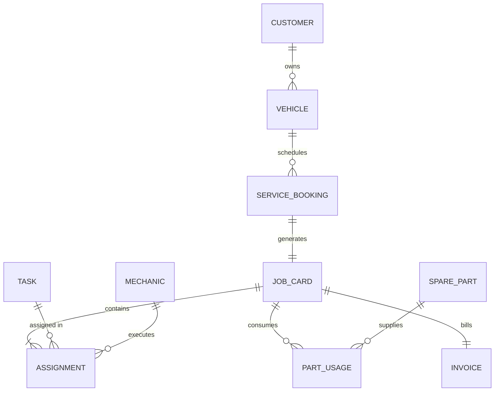

# Vehicle Service Centre Management System (RDBMS)

> **Database Management Systems (DBMS) — Project-Based Learning (PBL) Deliverable (Project 10)**  
> **School of Technology, Woxsen University**  
> **Course Faculty:** Prof. Sahithi  
> **Author:** G. Keerthan Chowdary (**Roll No:** `25WU0102076`)  

---

## 📑 Project Presentations & Documentation

All deliverables for Review 1, Review 2, and Review 3, as well as the comprehensive PBL Project Report, are available in this repository:

| Deliverable | Title & Scope | Files |
| :--- | :--- | :--- |
| **Review 1** | **System Architecture, Conceptual ER Modeling & Relational Design**<br>Problem statement, scope, 10 primary entities, cardinality, ER diagram. | 📊 [Review-1 Presentation (PPTX)](presentations/Review-1_Vehicle_Service_Centre.pptx)<br>📄 [Review-1 Document (PDF)](presentations/Review-1_Vehicle_Service_Centre.pdf) |
| **Review 2** | **3NF Normalization, DDL with Constraints, Sample Data & SQL Queries**<br>UNF-to-3NF normalization, DDL schema, triggers, sample dataset, analytical queries. | 📊 [Review-2 Presentation (PPTX)](presentations/Review-2_Vehicle_Service_Centre.pptx) |
| **Review 3** | **Python Web Application, Final Demonstration, Report & Viva-Voce**<br>End-to-end Python/Flask application, live demonstration, test cases, and viva prep. | 📊 [Review-3 Presentation (PPTX)](presentations/Review-3_Vehicle_Service_Centre.pptx) |
| **Full Report** | **Comprehensive DBMS Project-Based Learning Report**<br>Complete academic documentation including schema analysis, triggers, and testing results. | 📄 [DBMS Project Report (DOCX)](docs/DBMS_PBL_Report_Vehicle_Service_Centre.docx) |

---

## 🌐 Live Application & Quick Launch

- **Live Web Application:** [Vehicle Service Centre Management](https://89cfa03d00e924.lhr.life)
- **Local Quick Launch (Windows):** Double-click [`start_website.bat`](start_website.bat) on your desktop or project root to spin up the Flask backend and launch the web interface instantly at `http://127.0.0.1:5000`.

---

## 📌 Executive Summary & Problem Statement

Traditional automotive service centres frequently grapple with operational fragmentation, relying on paper job cards, handwritten registers, and unlinked spreadsheets. This creates serious operational bottlenecks:
- **Misplaced Repair Logs & Untracked Progress:** Absence of unified customer-vehicle hierarchies makes historical diagnostic tracking nearly impossible.
- **Resource Scheduling Clashes:** Workshop managers face scheduling conflicts when assigning mechanics to repair bays without real-time workload tracking.
- **Parts Inaccuracies & Unexpected Stockouts:** Unsynchronized spare parts consumption leads to invoicing errors, missing inventory, and parts depleted below safe thresholds.
- **Financial Discrepancies:** Inability to lock historical unit prices at the time of repair causes inconsistencies when future spare parts price revisions occur.

### Core Objectives
1. **Digitization & Structural Integrity:** Engineer a fully normalized 3NF relational database interconnecting customers, vehicles, service appointments, repair tasks, mechanics, parts, and billing.
2. **Database-Level Integrity Constraints:** Enforce mandatory domain, uniqueness, and referential constraints (`ON DELETE CASCADE`, composite `UNIQUE`, `CHECK` constraints).
3. **Automated Business Rules via Triggers:** Enforce zero-overlap mechanic bay scheduling, verify stock sufficiency prior to part issuance, and deduct inventory dynamically upon consumption.
4. **Transparent Financial Workflows:** Automatically compute labor hours, billable parts at historical unit prices, and apply 18% GST on finalized invoices.

---

## 🏗️ Conceptual ER Modeling & Entity Relationships

The relational architecture centers around ten core operational entities:



### Key Relationships & Cardinality
1. **Customer → Vehicle (`1:N`):** A single customer can register multiple vehicles; each vehicle links to exactly one primary owner.
2. **Vehicle → Service_Booking (`1:N`):** A vehicle maintains a history of multiple service bookings across dates.
3. **Service_Booking → Job_Card (`1:1`):** Each confirmed booking checked into the garage creates exactly one active `Job_Card` record.
4. **Job_Card ↔ Mechanic / Task (`M:N` via `Assignment`):** Resolved through the associative entity `Assignment`, linking mechanics to specific repair tasks on a job card while logging start and end times.
5. **Job_Card ↔ Spare_Part (`M:N` via `Part_Usage`):** Resolved through `Part_Usage`, recording quantity consumed and capturing `BilledUnitPrice` at transaction time.
6. **Job_Card → Invoice (`1:1`):** Closing a job card triggers the generation of exactly one consolidated invoice.

---

## 📐 Normalization to Third Normal Form (3NF)

| Form | Rule Applied | Project Outcome |
| :--- | :--- | :--- |
| **UNF** | Initial paper job card holding customer, vehicle, repair tasks, and spare parts together. | Repeating task groups, repeated vehicle/owner attributes on every visit, high data redundancy. |
| **1NF** | Atomic values, eliminate repeating groups, define primary keys for every entity. | Tasks and spare parts separated into dedicated tabular rows; composite keys formed. |
| **2NF** | Eliminate partial functional dependencies on composite keys. | Customer attributes depend on `CustomerID`, vehicle on `RegNo`, spare parts pricing on `PartID`, and labor rates on `TaskID`. Each moved to independent relation. |
| **3NF** | Eliminate transitive dependencies between non-key attributes. | Booking references only `RegNo` (not customer details). `M:N` relations resolved by `Assignment` and `Part_Usage`. Invoice totals reference `JobCardID`. |

> **Design Decision — Historical Price Snapshot:** In `Part_Usage`, the `BilledUnitPrice` column is deliberately stored at transaction time. This intentional denormalization prevents retrospective changes to historical invoices when current inventory catalog prices change.

---

## 🗄️ Relational Schema & Data Dictionary

| Relation / Table | Primary Key (PK) | Foreign Keys (FK) | Integrity Constraints & Check Conditions |
| :--- | :--- | :--- | :--- |
| **`Customer`** | `CustomerID` | None | `Phone` CHAR(10) UNIQUE NOT NULL, `Email` UNIQUE |
| **`Vehicle`** | `RegNo` | `CustomerID` (FK → `Customer`) | `MfgYear BETWEEN 1990 AND 2030`, `FuelType IN ('Petrol','Diesel','CNG','Electric')`, `ON DELETE CASCADE` |
| **`Service_Booking`** | `BookingID` | `RegNo` (FK → `Vehicle`) | `Status IN ('Booked','Checked-In','Completed','Cancelled')`, `UNIQUE(RegNo, BookingDate, SlotTime)` |
| **`Job_Card`** | `JobCardID` | `BookingID` (FK → `Service_Booking`, UNIQUE) | `JobStatus IN ('Open','In Progress','Closed')`, `CHECK(DateOut IS NULL OR DateOut >= DateIn)` |
| **`Mechanic`** | `MechanicID` | None | `Name` NOT NULL, `Phone` CHAR(10) UNIQUE |
| **`Task`** | `TaskID` | None | `TaskName` UNIQUE NOT NULL, `LaborRate >= 0` |
| **`Assignment`** | `AssignmentID` | `JobCardID`, `TaskID`, `MechanicID` | `EndTime IS NULL OR EndTime > StartTime`, `Status IN ('Assigned','In Progress','Completed')` |
| **`Spare_Part`** | `PartID` | None | `PartName` UNIQUE NOT NULL, `UnitPrice > 0`, `StockQty >= 0`, `ReorderLevel >= 0` |
| **`Part_Usage`** | `UsageID` | `JobCardID`, `PartID` | `Quantity > 0`, `BilledUnitPrice > 0` |
| **`Invoice`** | `InvoiceID` | `JobCardID` (FK → `Job_Card`, UNIQUE) | `PaymentStatus IN ('Unpaid','Paid')`, `LaborTotal >= 0`, `PartsTotal >= 0`, `NetAmount >= 0` |

---

## ⚡ Active Database Triggers

The system places core business logic directly inside the database engine to guarantee integrity across any client:

```sql
-- Trigger 1: Prevent mechanic overlapping schedule conflicts
CREATE TRIGGER trg_no_overlap
BEFORE INSERT ON Assignment
FOR EACH ROW
BEGIN
  SELECT CASE
    WHEN EXISTS (
      SELECT 1 FROM Assignment
      WHERE MechanicID = NEW.MechanicID
        AND (NEW.StartTime < EndTime AND NEW.EndTime > StartTime)
    )
    THEN RAISE(ABORT, 'Mechanic already booked in that time slot')
  END;
END;

-- Trigger 2: Prevent issuing spare parts when stock is insufficient
CREATE TRIGGER trg_check_stock
BEFORE INSERT ON Part_Usage
FOR EACH ROW
BEGIN
  SELECT CASE
    WHEN (SELECT StockQty FROM Spare_Part WHERE PartID = NEW.PartID) < NEW.Quantity
    THEN RAISE(ABORT, 'Insufficient stock')
  END;
END;

-- Trigger 3: Automatically deduct parts stock upon usage
CREATE TRIGGER trg_deduct_stock
AFTER INSERT ON Part_Usage
FOR EACH ROW
BEGIN
  UPDATE Spare_Part
  SET StockQty = StockQty - NEW.Quantity
  WHERE PartID = NEW.PartID;
END;
```

---

## 🔍 Analytical SQL Queries & Core Modules

### Q1. Vehicles with Owner Details (Join)
```sql
SELECT c.Name, c.Phone, v.RegNo, v.Make, v.Model, v.FuelType
FROM Customer c
JOIN Vehicle v ON v.CustomerID = c.CustomerID;
```

### Q2. Stock Depleted At or Below Reorder Level (Low Stock Alert)
```sql
SELECT PartID, PartName, StockQty, ReorderLevel
FROM Spare_Part
WHERE StockQty <= ReorderLevel;
```

### Q3. Live Repair Bay Workload (Active Assignments)
```sql
SELECT j.JobCardID, v.RegNo, t.TaskName, m.Name AS Mechanic, a.StartTime, a.EndTime
FROM Job_Card j
JOIN Service_Booking b ON b.BookingID = j.BookingID
JOIN Vehicle v        ON v.RegNo = b.RegNo
JOIN Assignment a     ON a.JobCardID = j.JobCardID
JOIN Task t           ON t.TaskID = a.TaskID
JOIN Mechanic m       ON m.MechanicID = a.MechanicID
WHERE j.JobStatus = 'In Progress';
```

### Q4. Mechanic Workload & Total Working Hours
```sql
SELECT m.Name, COUNT(a.AssignmentID) AS TotalTasks,
       ROUND(SUM((julianday(a.EndTime) - julianday(a.StartTime)) * 24), 2) AS TotalHours
FROM Mechanic m
JOIN Assignment a ON a.MechanicID = m.MechanicID
GROUP BY m.MechanicID, m.Name;
```

### Q5. Automated Invoice Generation with 18% GST (Billing Calculation)
```sql
INSERT INTO Invoice (JobCardID, LaborTotal, PartsTotal, NetAmount, PaymentStatus)
SELECT 
    1, 
    L.LaborAmt, 
    P.PartsAmt, 
    ROUND((L.LaborAmt + P.PartsAmt) * 1.18, 2),
    'Unpaid'
FROM 
    (SELECT IFNULL(SUM(t.LaborRate), 0) AS LaborAmt 
     FROM Assignment a JOIN Task t ON t.TaskID = a.TaskID WHERE a.JobCardID = 1) L,
    (SELECT IFNULL(SUM(u.Quantity * u.BilledUnitPrice), 0) AS PartsAmt 
     FROM Part_Usage u WHERE u.JobCardID = 1) P;
```

---

## 👥 Functional User Roles

```mermaid
flowchart TD
    SA["👤 Service Advisor"] -->|Registers| CU["Customers & Vehicles"]
    SA -->|Schedules| SB["Service Bookings"]
    SA -->|Generates| INV["Final Invoices"]

    SM["🔧 Service Mechanic"] -->|Views| ASS["Bay Assignments"]
    SM -->|Logs| TIM["Working Hours"]
    SM -->|Requests| PRT["Spare Parts"]

    IC["📦 Inventory Controller"] -->|Monitors| STK["Catalog & Stock Levels"]
    IC -->|Updates| REO["Reorder Thresholds"]
    IC -->|Issues| PU["Parts against Job Cards"]

    WM["📊 Workshop Manager"] -->|Analyzes| REV["Revenue & Invoices"]
    WM -->|Evaluates| EFF["Mechanic Productivity"]
    WM -->|Tracks| JCS["Workshop Turnaround Time"]
```



---

## 🧪 Test Suite & Integrity Validation

All operational scenarios and negative integrity constraints were rigorously tested:

| Test # | Test Scenario | Expected Constraint Action | Result |
| :---: | :--- | :--- | :---: |
| **TC-01** | Duplicate booking for same vehicle in same slot (`TS09AB1234` on `2026-10-12 10:00`) | Rejected by composite `UNIQUE(RegNo, BookingDate, SlotTime)` | **PASS** |
| **TC-02** | Overlapping repair window for same mechanic (`10:30 - 11:30` vs existing `10:15 - 10:45`) | Blocked by trigger `trg_no_overlap` | **PASS** |
| **TC-03** | Requesting 5 Brake Pad Sets when inventory balance is 3 | Blocked by trigger `trg_check_stock` (`Insufficient stock`) | **PASS** |
| **TC-04** | Issuing 1 Brake Pad Set when inventory balance is 3 | Allowed; stock automatically drops from 3 to 2 via `trg_deduct_stock` | **PASS** |
| **TC-05** | Final invoice generation for Job Card 1 (Labor: ₹1,100 + Parts: ₹3,600 + 18% GST) | Net amount matches `(1100 + 3600) * 1.18 = ₹5,546.00` | **PASS** |
| **TC-06** | Stock level verification after part consumption | Part flagged as **Low Stock** since current stock (2) <= reorder level (5) | **PASS** |

---

## 💻 Tech Stack & Project Structure

- **Backend:** Python 3.13, Flask 3.1
- **Database Engine:** SQLite 3 with strict foreign keys enabled (`PRAGMA foreign_keys = ON;`)
- **Frontend:** HTML5, CSS3, Bootstrap 5.3, FontAwesome 6, Chart.js
- **WSGI / Cloud:** Gunicorn (production ready)

```text
vehicle_service_centre/
├── app.py                     # Flask web server and routing logic
├── init_db.py                 # DDL schema script, triggers, and sample data population
├── start_website.bat          # Desktop launch runner for Windows
├── requirements.txt           # Python dependencies
├── presentations/             # Academic review slide decks
│   ├── Review-1_Vehicle_Service_Centre.pptx
│   ├── Review-1_Vehicle_Service_Centre.pdf
│   ├── Review-2_Vehicle_Service_Centre.pptx
│   └── Review-3_Vehicle_Service_Centre.pptx
├── docs/                      # Comprehensive PBL documentation
│   ├── DBMS_PBL_Report_Vehicle_Service_Centre.docx
│   └── slides/                # Extracted slide figures and diagrams
└── templates/                 # Jinja2 HTML5 UI templates
    ├── base.html              # Layout with navigation and author profile
    ├── index.html             # Command Center dashboard with Chart.js
    ├── customers.html         # Customer registry and registration form
    ├── vehicles.html          # Vehicle fleet tracking
    ├── bookings.html          # Service booking calendar
    ├── job_cards.html         # Job card bay monitoring
    ├── inventory.html         # Spare parts stock and replenishment
    └── billing.html           # Invoices, labor/parts breakdown, and GST totals
```

---

## 🚀 Setup & Execution Guide

### 1. Prerequisites
Ensure Python 3.10 or higher is installed on your computer.

### 2. Clone the Repository
```bash
git clone https://github.com/keerthanchowdary0369/vehicle-service-centre.git
cd vehicle-service-centre
```

### 3. Install Dependencies
```bash
pip install -r requirements.txt
```

### 4. Initialize the Database
```bash
python init_db.py
```

### 5. Launch the Web Application
```bash
python app.py
```
Open your browser and navigate to **`http://127.0.0.1:5000`**.

---

## 👨‍💻 Project Information & Attribution

- **Student:** G. Keerthan Chowdary
- **Roll Number:** `25WU0102076`
- **Institution:** School of Technology, Woxsen University
- **Course:** Database Management Systems (Project-Based Learning)
- **Academic Year:** 2026
