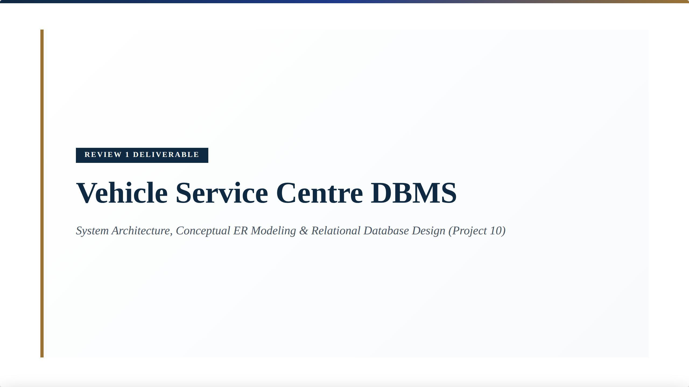
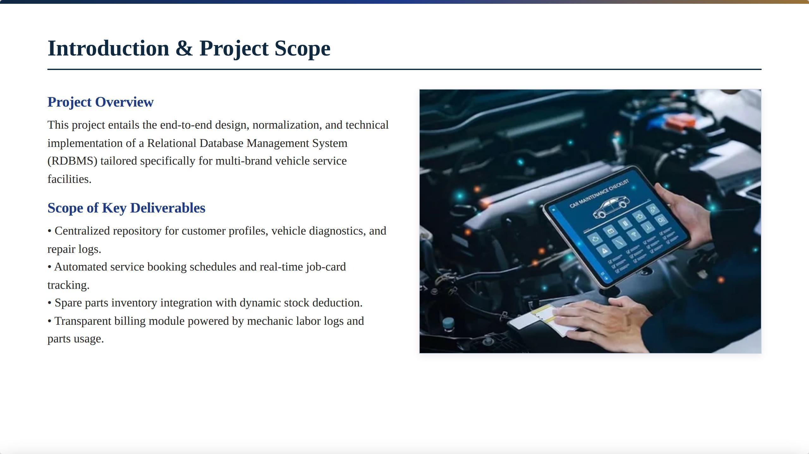
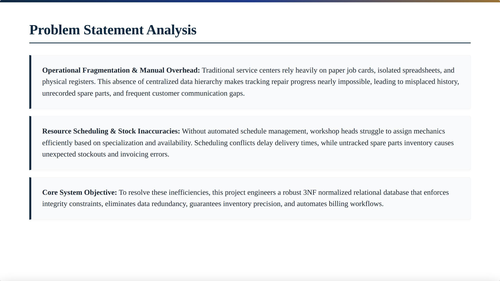
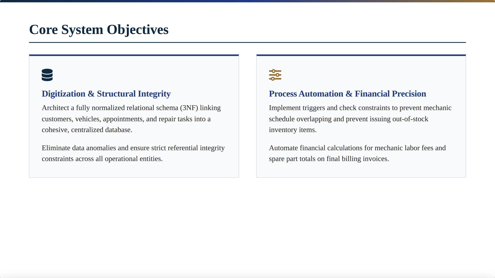
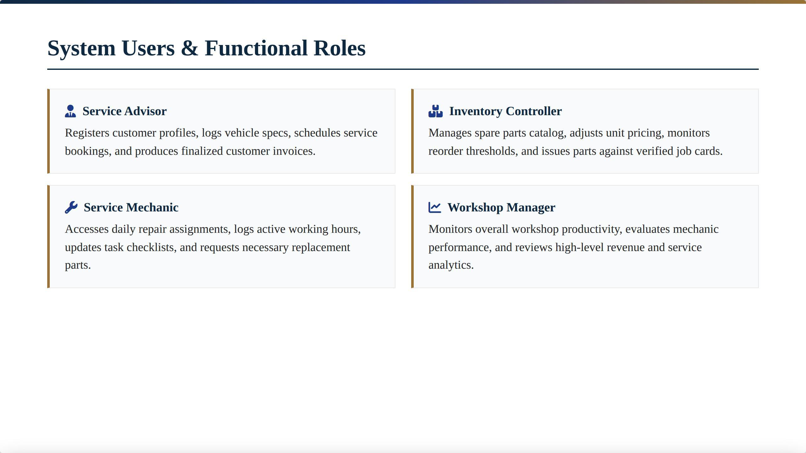
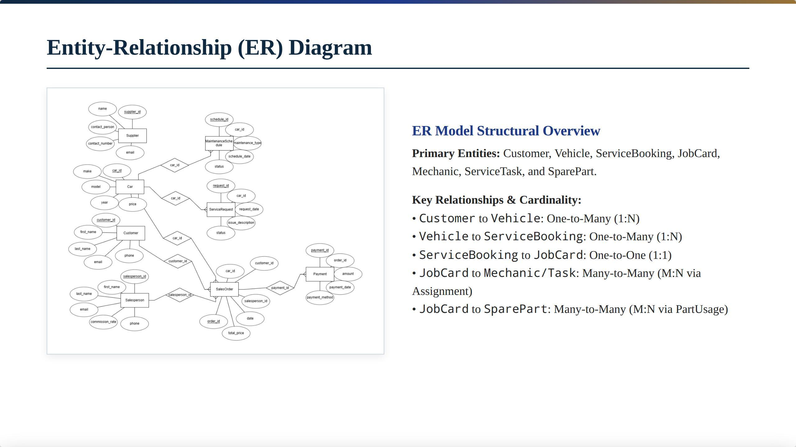
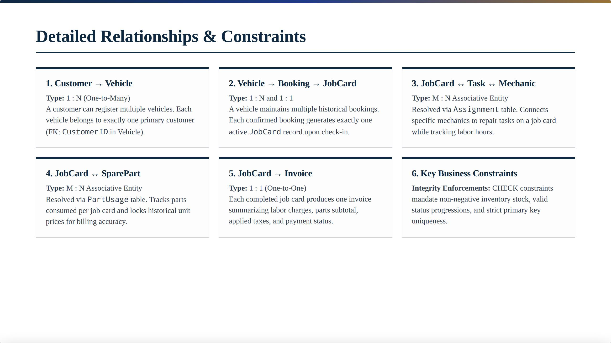
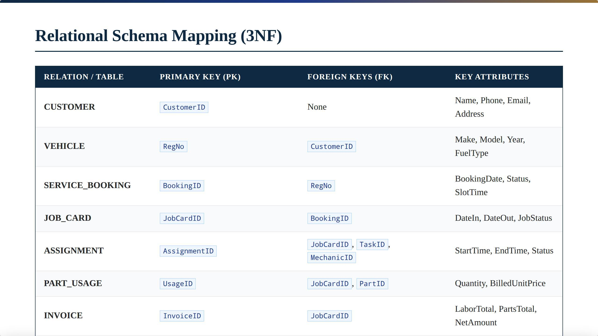
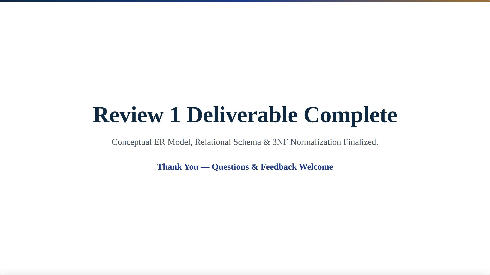
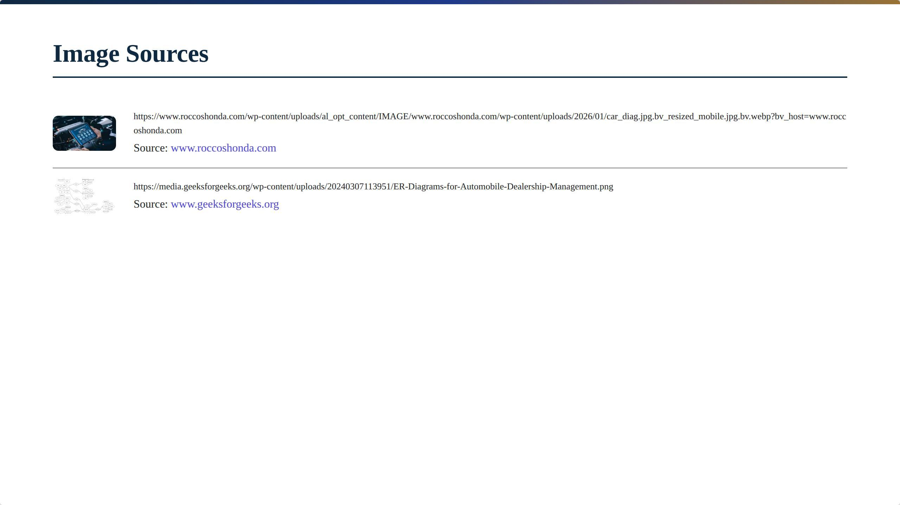

# Review 1 Deliverable: Vehicle Service Centre DBMS

> **System Architecture, Conceptual ER Modeling & Relational Database Design (Project 10)**  
> **Author:** G. Keerthan Chowdary (Roll No: `25WU0102076`)  
> **Institution:** School of Technology, Woxsen University  
> **Course Faculty:** Prof. Sahithi  

📄 **[Click here to view the PDF version directly in GitHub](Review-1-Deliverable.pdf)**

---

## Slide 1: Title Slide

---

## Slide 2: Introduction & Project Scope

### Key Deliverables:
- Centralized repository for customer profiles, vehicle diagnostics, and repair logs.
- Automated service booking schedules and real-time job-card tracking.
- Spare parts inventory integration with dynamic stock deduction.
- Transparent billing module powered by mechanic labor logs and parts usage.

---

## Slide 3: Problem Statement Analysis

### Core Analysis:
- **Operational Fragmentation & Manual Overhead:** Traditional service centers rely heavily on paper job cards, isolated spreadsheets, and physical registers. This absence of centralized data hierarchy makes tracking repair progress nearly impossible.
- **Resource Scheduling & Stock Inaccuracies:** Without automated schedule management, workshop heads struggle to assign mechanics efficiently based on specialization and availability. Scheduling conflicts delay delivery times, while untracked spare parts inventory causes unexpected stockouts and invoicing errors.
- **Core System Objective:** To resolve these inefficiencies, this project engineers a robust 3NF normalized relational database that enforces integrity constraints, eliminates data redundancy, guarantees inventory precision, and automates billing workflows.

---

## Slide 4: Core System Objectives

### Objectives Overview:
- **Digitization & Structural Integrity:** Architect a fully normalized relational schema (3NF) linking customers, vehicles, appointments, and repair tasks into a cohesive, centralized database. Eliminate data anomalies and ensure strict referential integrity constraints across all operational entities.
- **Process Automation & Financial Precision:** Implement triggers and check constraints to prevent mechanic schedule overlapping and prevent issuing out-of-stock inventory items. Automate financial calculations for mechanic labor fees and spare part totals on final billing invoices.

---

## Slide 5: System Users & Functional Roles

### User Personas & Responsibilities:
- **Service Advisor:** Registers customer profiles, logs vehicle specs, schedules service bookings, and produces finalized customer invoices.
- **Service Mechanic:** Accesses daily repair assignments, logs active working hours, updates task checklists, and requests necessary replacement parts.
- **Inventory Controller:** Manages spare parts catalog, adjusts unit pricing, monitors reorder thresholds, and issues parts against verified job cards.
- **Workshop Manager:** Monitors overall workshop productivity, evaluates mechanic performance, and reviews high-level revenue and service analytics.

---

## Slide 6: Conceptual Design & ER Modeling

Formalizing entities, attributes, structural constraints, and relationship cardinalities.

---

## Slide 7: Entity-Relationship (ER) Diagram

### ER Model Structural Overview:
- **Primary Entities:** Customer, Vehicle, ServiceBooking, JobCard, Mechanic, ServiceTask, and SparePart.
- **Key Relationships & Cardinality:**
  - Customer to Vehicle: One-to-Many (`1:N`)
  - Vehicle to ServiceBooking: One-to-Many (`1:N`)
  - ServiceBooking to JobCard: One-to-One (`1:1`)
  - JobCard to Mechanic/Task: Many-to-Many (`M:N` via Assignment)
  - JobCard to SparePart: Many-to-Many (`M:N` via PartUsage)

---

## Slide 8: Detailed Relationships & Constraints

### Constraints Breakdown:
1. **Customer → Vehicle (`1:N`):** A customer can register multiple vehicles. Each vehicle belongs to exactly one primary customer (`FK: CustomerID in Vehicle`).
2. **Vehicle → Booking → JobCard (`1:N` & `1:1`):** A vehicle maintains multiple historical bookings. Each confirmed booking generates exactly one active `JobCard` record upon check-in.
3. **JobCard ↔ Task ↔ Mechanic (`M:N` Associative Entity):** Resolved via `Assignment` table. Connects specific mechanics to repair tasks on a job card while tracking labor hours.
4. **JobCard ↔ SparePart (`M:N` Associative Entity):** Resolved via `PartUsage` table. Tracks parts consumed per job card and locks historical unit prices for billing accuracy.
5. **JobCard → Invoice (`1:1`):** Each completed job card produces one invoice summarizing labor charges, parts subtotal, applied taxes, and payment status.
6. **Key Business Constraints:** Integrity Enforcements: `CHECK` constraints mandate non-negative inventory stock, valid status progressions, and strict primary key uniqueness.

---

## Slide 9: Relational Schema Mapping (3NF)

| Relation / Table | Primary Key (PK) | Foreign Keys (FK) | Key Attributes |
| :--- | :--- | :--- | :--- |
| **CUSTOMER** | `CustomerID` | None | Name, Phone, Email, Address |
| **VEHICLE** | `RegNo` | `CustomerID` | Make, Model, Year, FuelType |
| **SERVICE_BOOKING** | `BookingID` | `RegNo` | BookingDate, Status, SlotTime |
| **JOB_CARD** | `JobCardID` | `BookingID` | DateIn, DateOut, JobStatus |
| **ASSIGNMENT** | `AssignmentID` | `JobCardID`, `TaskID`, `MechanicID` | StartTime, EndTime, Status |
| **PART_USAGE** | `UsageID` | `JobCardID`, `PartID` | Quantity, BilledUnitPrice |
| **INVOICE** | `InvoiceID` | `JobCardID` | LaborTotal, PartsTotal, NetAmount |

---

## Slide 10: Review 1 Deliverable Complete

Conceptual ER Model, Relational Schema & 3NF Normalization Finalized.

---

## Slide 11: Image Sources

---
*End of Review 1 Deliverable*
