# Review 2 Deliverable: Vehicle Service Centre DBMS

> **3NF Normalization, DDL with Constraints, Sample Data & SQL Queries (Project 10)**  
> **Author:** G. Keerthan Chowdary (Roll No: `25WU0102076`)  
> **Institution:** School of Technology, Woxsen University  
> **Course Faculty:** Prof. Sahithi  

📄 **[Click here to view the PDF version directly in GitHub](Review-2-Deliverable.pdf)**

---

## Slide 1: Title Slide
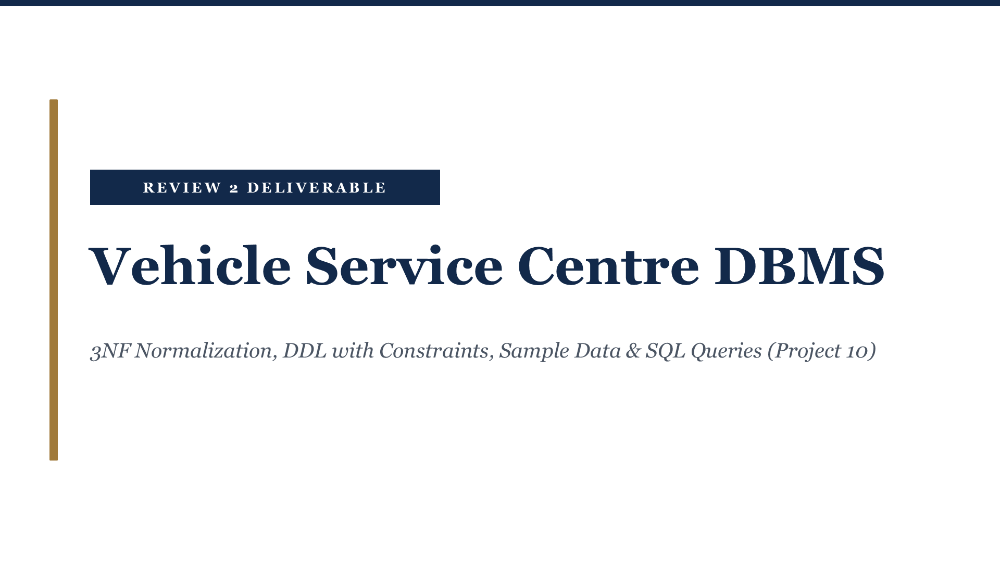

### Review 2 Deliverable Overview
- **Project Title:** Vehicle Service Centre DBMS
- **Deliverables Covered:** 3NF Normalization, DDL with Constraints, Sample Data & SQL Queries
- **Scope:** Complete relational database engineering with strict declarative constraints and active database triggers.

---

## Slide 2: Normalization to Third Normal Form
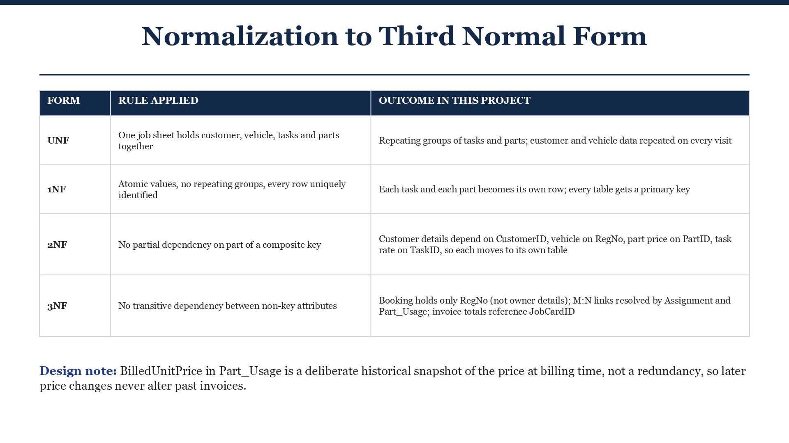

| Form | Rule Applied | Outcome in this Project |
| :--- | :--- | :--- |
| **UNF** | One job sheet holds customer, vehicle, tasks and parts together | Repeating groups of tasks and parts; customer and vehicle data repeated on every visit |
| **1NF** | Atomic values, no repeating groups, every row uniquely identified | Each task and each part becomes its own row; every table gets a primary key |
| **2NF** | No partial dependency on part of a composite key | Customer details depend on CustomerID, vehicle on RegNo, part price on PartID, task rate on TaskID, so each moves to its own table |
| **3NF** | No transitive dependency between non-key attributes | Booking holds only RegNo (not owner details); M:N links resolved by Assignment and Part_Usage; invoice totals reference JobCardID |

> **Design note:** `BilledUnitPrice` in `Part_Usage` is a deliberate historical snapshot of the price at billing time, not a redundancy, so later price changes never alter past invoices.

---

## Slide 3: Final Relational Schema (3NF)
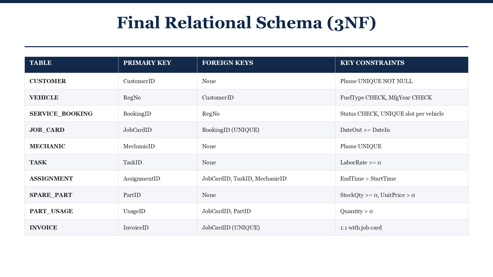

| Table | Primary Key | Foreign Keys | Key Constraints |
| :--- | :--- | :--- | :--- |
| **CUSTOMER** | `CustomerID` | None | `Phone` UNIQUE NOT NULL |
| **VEHICLE** | `RegNo` | `CustomerID` | `FuelType` CHECK, `MfgYear` CHECK |
| **SERVICE_BOOKING** | `BookingID` | `RegNo` | `Status` CHECK, UNIQUE slot per vehicle |
| **JOB_CARD** | `JobCardID` | `BookingID` (UNIQUE) | `DateOut >= DateIn` |
| **MECHANIC** | `MechanicID` | None | `Phone` UNIQUE |
| **TASK** | `TaskID` | None | `LaborRate >= 0` |
| **ASSIGNMENT** | `AssignmentID` | `JobCardID`, `TaskID`, `MechanicID` | `EndTime > StartTime` |
| **SPARE_PART** | `PartID` | None | `StockQty >= 0`, `UnitPrice > 0` |
| **PART_USAGE** | `UsageID` | `JobCardID`, `PartID` | `Quantity > 0` |
| **INVOICE** | `InvoiceID` | `JobCardID` (UNIQUE) | 1:1 with job card |

---

## Slide 4: DDL: Customer & Vehicle
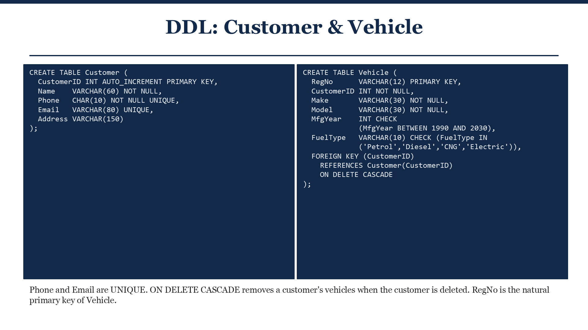

```sql
CREATE TABLE Customer (
  CustomerID INT AUTO_INCREMENT PRIMARY KEY,
  Name    VARCHAR(60) NOT NULL,
  Phone   CHAR(10) NOT NULL UNIQUE,
  Email   VARCHAR(80) UNIQUE,
  Address VARCHAR(150)
);

CREATE TABLE Vehicle (
  RegNo      VARCHAR(12) PRIMARY KEY,
  CustomerID INT NOT NULL,
  Make       VARCHAR(30) NOT NULL,
  Model      VARCHAR(30) NOT NULL,
  MfgYear    INT CHECK (MfgYear BETWEEN 1990 AND 2030),
  FuelType   VARCHAR(10) CHECK (FuelType IN ('Petrol','Diesel','CNG','Electric')),
  FOREIGN KEY (CustomerID) REFERENCES Customer(CustomerID) ON DELETE CASCADE
);
```

> **Design notes:** `Phone` and `Email` are `UNIQUE`. `ON DELETE CASCADE` removes a customer's vehicles when the customer is deleted. `RegNo` is the natural primary key of `Vehicle`.

---

## Slide 5: DDL: Service Booking & Job Card
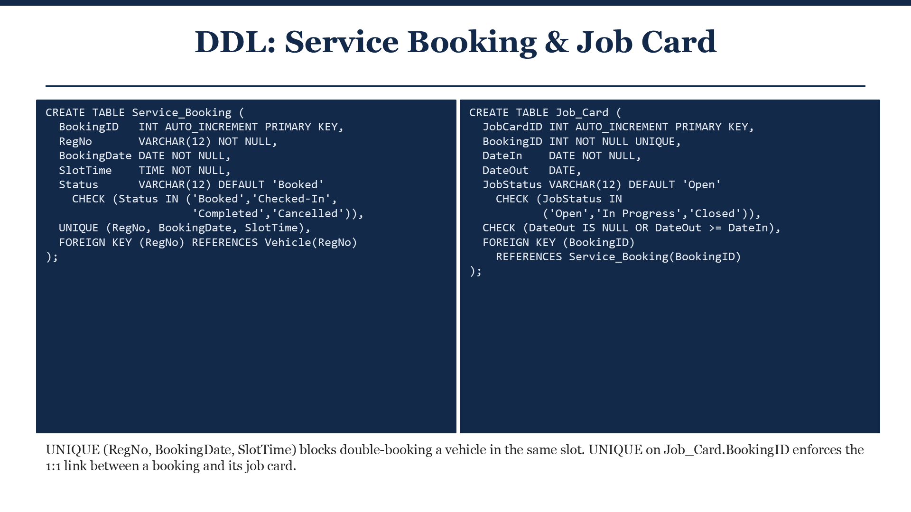

```sql
CREATE TABLE Service_Booking (
  BookingID   INT AUTO_INCREMENT PRIMARY KEY,
  RegNo       VARCHAR(12) NOT NULL,
  BookingDate DATE NOT NULL,
  SlotTime    TIME NOT NULL,
  Status      VARCHAR(12) DEFAULT 'Booked' CHECK (Status IN ('Booked','Checked-In','Completed','Cancelled')),
  UNIQUE (RegNo, BookingDate, SlotTime),
  FOREIGN KEY (RegNo) REFERENCES Vehicle(RegNo)
);

CREATE TABLE Job_Card (
  JobCardID INT AUTO_INCREMENT PRIMARY KEY,
  BookingID INT NOT NULL UNIQUE,
  DateIn    DATE NOT NULL,
  DateOut   DATE,
  JobStatus VARCHAR(12) DEFAULT 'Open' CHECK (JobStatus IN ('Open','In Progress','Closed')),
  CHECK (DateOut IS NULL OR DateOut >= DateIn),
  FOREIGN KEY (BookingID) REFERENCES Service_Booking(BookingID)
);
```

> **Design notes:** `UNIQUE (RegNo, BookingDate, SlotTime)` blocks double-booking a vehicle in the same slot. `UNIQUE` on `Job_Card.BookingID` enforces the 1:1 link between a booking and its job card.

---

## Slide 6: DDL: Mechanic, Task & Assignment
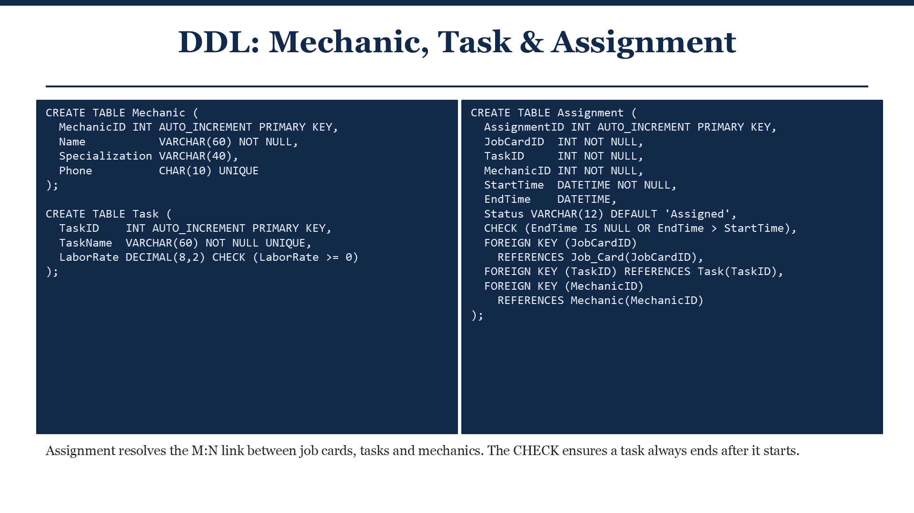

```sql
CREATE TABLE Mechanic (
  MechanicID INT AUTO_INCREMENT PRIMARY KEY,
  Name           VARCHAR(60) NOT NULL,
  Specialization VARCHAR(40),
  Phone          CHAR(10) UNIQUE
);

CREATE TABLE Task (
  TaskID    INT AUTO_INCREMENT PRIMARY KEY,
  TaskName  VARCHAR(60) NOT NULL UNIQUE,
  LaborRate DECIMAL(8,2) CHECK (LaborRate >= 0)
);

CREATE TABLE Assignment (
  AssignmentID INT AUTO_INCREMENT PRIMARY KEY,
  JobCardID  INT NOT NULL,
  TaskID     INT NOT NULL,
  MechanicID INT NOT NULL,
  StartTime  DATETIME NOT NULL,
  EndTime    DATETIME,
  Status VARCHAR(12) DEFAULT 'Assigned',
  CHECK (EndTime IS NULL OR EndTime > StartTime),
  FOREIGN KEY (JobCardID) REFERENCES Job_Card(JobCardID),
  FOREIGN KEY (TaskID) REFERENCES Task(TaskID),
  FOREIGN KEY (MechanicID) REFERENCES Mechanic(MechanicID)
);
```

> **Design notes:** `Assignment` resolves the `M:N` link between job cards, tasks, and mechanics. The `CHECK` constraint ensures a task always ends after it starts.

---

## Slide 7: DDL: Spare Parts, Usage & Invoice
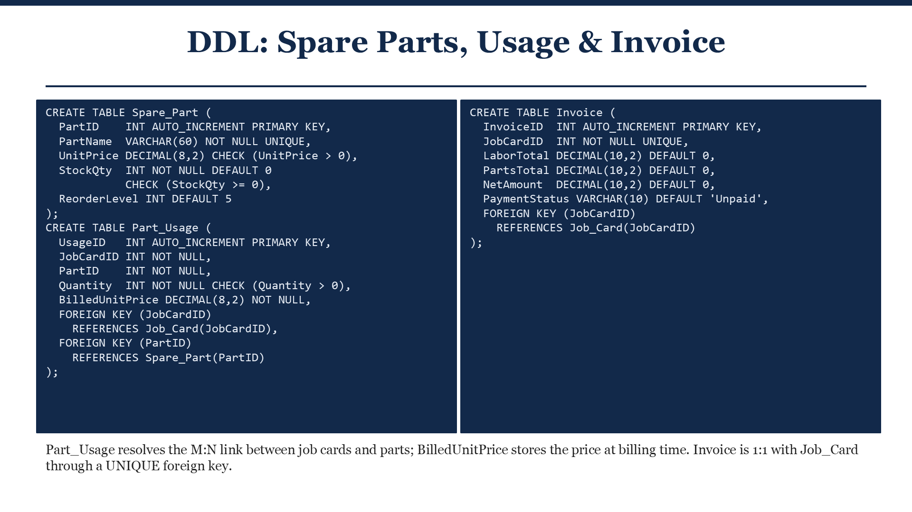

```sql
CREATE TABLE Spare_Part (
  PartID    INT AUTO_INCREMENT PRIMARY KEY,
  PartName  VARCHAR(60) NOT NULL UNIQUE,
  UnitPrice DECIMAL(8,2) CHECK (UnitPrice > 0),
  StockQty  INT NOT NULL DEFAULT 0 CHECK (StockQty >= 0),
  ReorderLevel INT DEFAULT 5
);

CREATE TABLE Part_Usage (
  UsageID   INT AUTO_INCREMENT PRIMARY KEY,
  JobCardID INT NOT NULL,
  PartID    INT NOT NULL,
  Quantity  INT NOT NULL CHECK (Quantity > 0),
  BilledUnitPrice DECIMAL(8,2) NOT NULL,
  FOREIGN KEY (JobCardID) REFERENCES Job_Card(JobCardID),
  FOREIGN KEY (PartID) REFERENCES Spare_Part(PartID)
);

CREATE TABLE Invoice (
  InvoiceID  INT AUTO_INCREMENT PRIMARY KEY,
  JobCardID  INT NOT NULL UNIQUE,
  LaborTotal DECIMAL(10,2) DEFAULT 0,
  PartsTotal DECIMAL(10,2) DEFAULT 0,
  NetAmount  DECIMAL(10,2) DEFAULT 0,
  PaymentStatus VARCHAR(10) DEFAULT 'Unpaid',
  FOREIGN KEY (JobCardID) REFERENCES Job_Card(JobCardID)
);
```

> **Design notes:** `Part_Usage` resolves the `M:N` link between job cards and parts; `BilledUnitPrice` stores the price at billing time. `Invoice` is 1:1 with `Job_Card` through a `UNIQUE` foreign key.

---

## Slide 8: Sample Data (1/2): Customers & Bookings
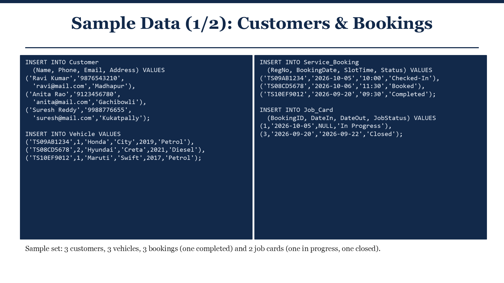

```sql
INSERT INTO Customer (Name, Phone, Email, Address) VALUES
('Ravi Kumar',  '9876543210', 'ravi@mail.com',  'Madhapur'),
('Anita Rao',   '9123456780', 'anita@mail.com', 'Gachibowli'),
('Suresh Reddy','9988776655', 'suresh@mail.com','Kukatpally');

INSERT INTO Vehicle VALUES
('TS09AB1234', 1, 'Honda',  'City',  2019, 'Petrol'),
('TS08CD5678', 2, 'Hyundai','Creta', 2021, 'Diesel'),
('TS10EF9012', 1, 'Maruti', 'Swift', 2017, 'Petrol');

INSERT INTO Service_Booking (RegNo, BookingDate, SlotTime, Status) VALUES
('TS09AB1234', '2026-10-05', '10:00', 'Checked-In'),
('TS08CD5678', '2026-10-06', '11:30', 'Booked'),
('TS10EF9012', '2026-09-20', '09:30', 'Completed');

INSERT INTO Job_Card (BookingID, DateIn, DateOut, JobStatus) VALUES
(1, '2026-10-05', NULL,         'In Progress'),
(3, '2026-09-20', '2026-09-22', 'Closed');
```

> **Sample set:** 3 customers, 3 vehicles, 3 bookings (one completed), and 2 job cards (one in progress, one closed).

---

## Slide 9: Sample Data (2/2): Work, Parts & Billing
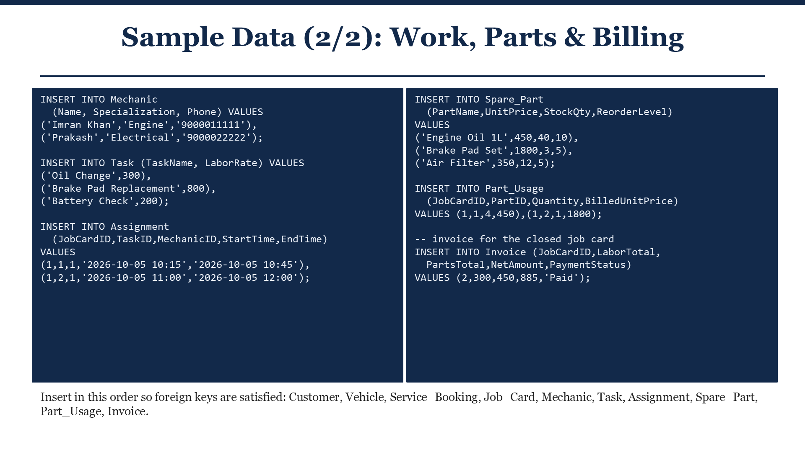

```sql
INSERT INTO Mechanic (Name, Specialization, Phone) VALUES
('Imran Khan', 'Engine',     '9000011111'),
('Prakash',    'Electrical', '9000022222');

INSERT INTO Task (TaskName, LaborRate) VALUES
('Oil Change',             300),
('Brake Pad Replacement',  800),
('Battery Check',          200);

INSERT INTO Assignment (JobCardID, TaskID, MechanicID, StartTime, EndTime) VALUES
(1, 1, 1, '2026-10-05 10:15', '2026-10-05 10:45'),
(1, 2, 1, '2026-10-05 11:00', '2026-10-05 12:00');

INSERT INTO Spare_Part (PartName, UnitPrice, StockQty, ReorderLevel) VALUES
('Engine Oil 1L',  450,  40, 10),
('Brake Pad Set', 1800,   3,  5),
('Air Filter',     350,  12,  5);

INSERT INTO Part_Usage (JobCardID, PartID, Quantity, BilledUnitPrice) VALUES
(1, 1, 4,  450),
(1, 2, 1, 1800);

-- Invoice for the closed job card
INSERT INTO Invoice (JobCardID, LaborTotal, PartsTotal, NetAmount, PaymentStatus) VALUES
(2, 300, 450, 885, 'Paid');
```

> **Insert Order:** Insert in this sequence so foreign keys are satisfied: Customer $\rightarrow$ Vehicle $\rightarrow$ Service_Booking $\rightarrow$ Job_Card $\rightarrow$ Mechanic $\rightarrow$ Task $\rightarrow$ Assignment $\rightarrow$ Spare_Part $\rightarrow$ Part_Usage $\rightarrow$ Invoice.

---

## Slide 10: SQL Queries (1/3): Lookups & Joins
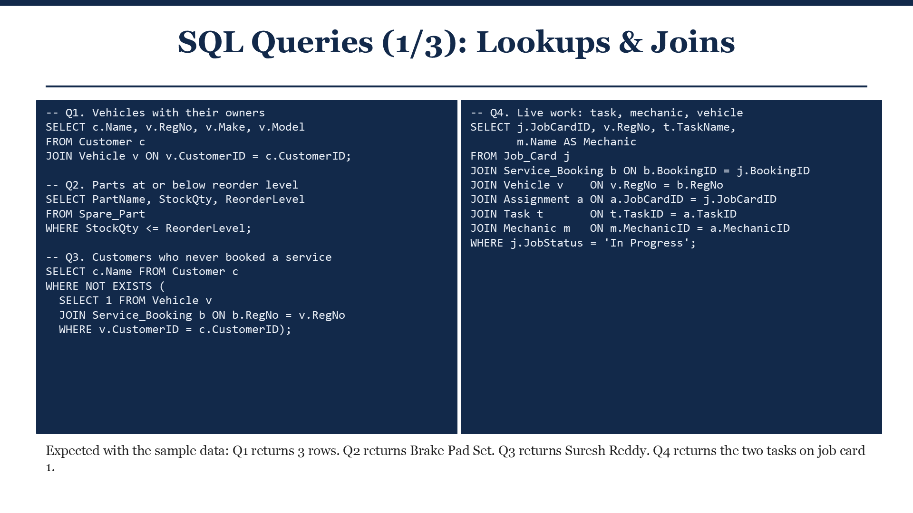

```sql
-- Q1. Vehicles with their owners
SELECT c.Name, v.RegNo, v.Make, v.Model
FROM Customer c
JOIN Vehicle v ON v.CustomerID = c.CustomerID;

-- Q2. Parts at or below reorder level
SELECT PartName, StockQty, ReorderLevel
FROM Spare_Part
WHERE StockQty <= ReorderLevel;

-- Q3. Customers who never booked a service
SELECT c.Name FROM Customer c
WHERE NOT EXISTS (
  SELECT 1 FROM Vehicle v
  JOIN Service_Booking b ON b.RegNo = v.RegNo
  WHERE v.CustomerID = c.CustomerID
);

-- Q4. Live work: task, mechanic, vehicle
SELECT j.JobCardID, v.RegNo, t.TaskName, m.Name AS Mechanic
FROM Job_Card j
JOIN Service_Booking b ON b.BookingID = j.BookingID
JOIN Vehicle v    ON v.RegNo = b.RegNo
JOIN Assignment a ON a.JobCardID = j.JobCardID
JOIN Task t       ON t.TaskID = a.TaskID
JOIN Mechanic m   ON m.MechanicID = a.MechanicID
WHERE j.JobStatus = 'In Progress';
```

> **Expected results:** Q1 returns 3 rows. Q2 returns `Brake Pad Set`. Q3 returns `Suresh Reddy`. Q4 returns the two tasks on Job Card 1.

---

## Slide 11: SQL Queries (2/3): Aggregation
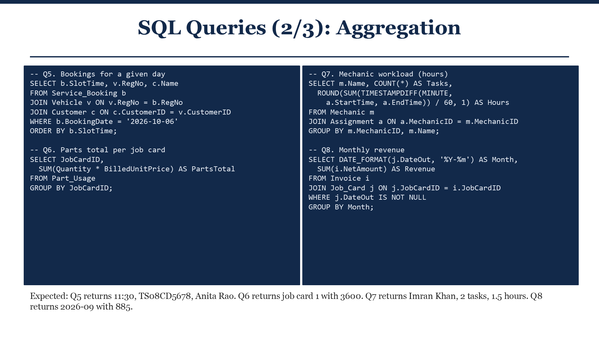

```sql
-- Q5. Bookings for a given day
SELECT b.SlotTime, v.RegNo, c.Name
FROM Service_Booking b
JOIN Vehicle v ON v.RegNo = b.RegNo
JOIN Customer c ON c.CustomerID = v.CustomerID
WHERE b.BookingDate = '2026-10-06'
ORDER BY b.SlotTime;

-- Q6. Parts total per job card
SELECT JobCardID, SUM(Quantity * BilledUnitPrice) AS PartsTotal
FROM Part_Usage
GROUP BY JobCardID;

-- Q7. Mechanic workload (hours)
SELECT m.Name, COUNT(*) AS Tasks,
  ROUND(SUM(TIMESTAMPDIFF(MINUTE, a.StartTime, a.EndTime)) / 60, 1) AS Hours
FROM Mechanic m
JOIN Assignment a ON a.MechanicID = m.MechanicID
GROUP BY m.MechanicID, m.Name;

-- Q8. Monthly revenue
SELECT DATE_FORMAT(j.DateOut, '%Y-%m') AS Month, SUM(i.NetAmount) AS Revenue
FROM Invoice i
JOIN Job_Card j ON j.JobCardID = i.JobCardID
WHERE j.DateOut IS NOT NULL
GROUP BY Month;
```

> **Expected results:** Q5 returns 11:30, `TS08CD5678`, Anita Rao. Q6 returns job card 1 with 3600. Q7 returns Imran Khan, 2 tasks, 1.5 hours. Q8 returns 2026-09 with 885.

---

## Slide 12: SQL Queries (3/3): Billing
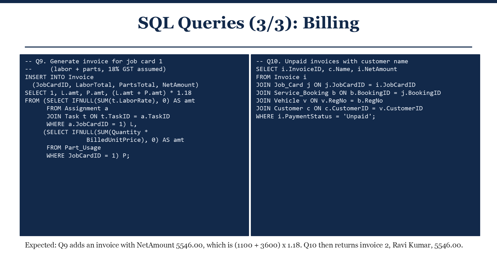

```sql
-- Q9. Generate invoice for job card 1 (labor + parts, 18% GST assumed)
INSERT INTO Invoice (JobCardID, LaborTotal, PartsTotal, NetAmount)
SELECT 1, L.amt, P.amt, (L.amt + P.amt) * 1.18
FROM (SELECT IFNULL(SUM(t.LaborRate), 0) AS amt
      FROM Assignment a
      JOIN Task t ON t.TaskID = a.TaskID
      WHERE a.JobCardID = 1) L,
     (SELECT IFNULL(SUM(Quantity * BilledUnitPrice), 0) AS amt
      FROM Part_Usage
      WHERE JobCardID = 1) P;

-- Q10. Unpaid invoices with customer name
SELECT i.InvoiceID, c.Name, i.NetAmount
FROM Invoice i
JOIN Job_Card j ON j.JobCardID = i.JobCardID
JOIN Service_Booking b ON b.BookingID = j.BookingID
JOIN Vehicle v ON v.RegNo = b.RegNo
JOIN Customer c ON c.CustomerID = v.CustomerID
WHERE i.PaymentStatus = 'Unpaid';
```

> **Expected results:** Q9 adds an invoice with `NetAmount 5546.00` `((1100 + 3600) * 1.18)`. Q10 returns invoice 2, Ravi Kumar, 5546.00.

---

## Slide 13: Integrity Enforcement & Stock Trigger
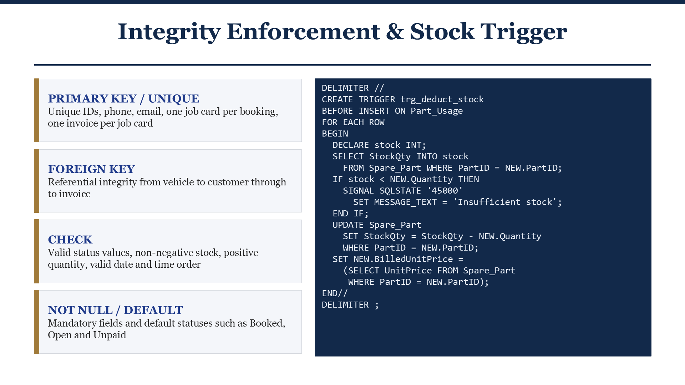

### Summary of Integrity Enforcements:
- **PRIMARY KEY / UNIQUE:** Unique IDs, phone, email, one job card per booking, one invoice per job card.
- **FOREIGN KEY:** Referential integrity from vehicle to customer through to invoice.
- **CHECK:** Valid status values, non-negative stock, positive quantity, valid date and time order.
- **NOT NULL / DEFAULT:** Mandatory fields and default statuses such as `Booked`, `Open`, and `Unpaid`.

```sql
DELIMITER //
CREATE TRIGGER trg_deduct_stock
BEFORE INSERT ON Part_Usage
FOR EACH ROW
BEGIN
  DECLARE stock INT;
  SELECT StockQty INTO stock
    FROM Spare_Part WHERE PartID = NEW.PartID;
  IF stock < NEW.Quantity THEN
    SIGNAL SQLSTATE '45000'
      SET MESSAGE_TEXT = 'Insufficient stock';
  END IF;
  UPDATE Spare_Part
    SET StockQty = StockQty - NEW.Quantity
    WHERE PartID = NEW.PartID;
  SET NEW.BilledUnitPrice =
    (SELECT UnitPrice FROM Spare_Part
     WHERE PartID = NEW.PartID);
END//
DELIMITER ;
```

---

## Slide 14: Review 2 Deliverable Complete
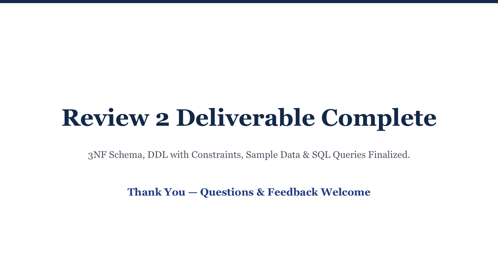

### Summary of Accomplishments:
- 3NF Schema & Entity Mapping finalized.
- Complete DDL with declarative constraints.
- Seeded sample dataset adhering to foreign key dependencies.
- Formulated 10 production SQL queries across joins, aggregations, and automated billing.
- Active database trigger for stock deduction and sufficiency verification.

---
*End of Review 2 Deliverable*
