# Review 3 Deliverable: AutoCore VSC Website & Final Demonstration

> **Vehicle Service Centre Management System — Final Demonstration, Report & Viva-Voce (Project 10)**  
> **Author:** G. Keerthan Chowdary (Roll No: `25WU0102076`)  
> **Institution:** School of Technology, Woxsen University  
> **Course Faculty:** Prof. Sahithi  

📄 **[Click here to view the PDF version directly in GitHub](Review-3-Deliverable.pdf)**

---

## Slide 1: Title Slide
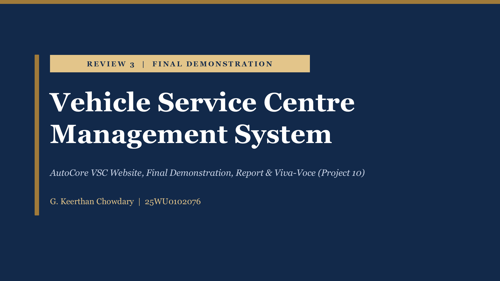

### Final Demonstration Overview
- **Project Title:** Vehicle Service Centre Management System
- **Focus:** AutoCore VSC Website, Final Demonstration, Report & Viva-Voce
- **Student:** G. Keerthan Chowdary | Roll Number: `25WU0102076`

---

## Slide 2: Review 3 Deliverables
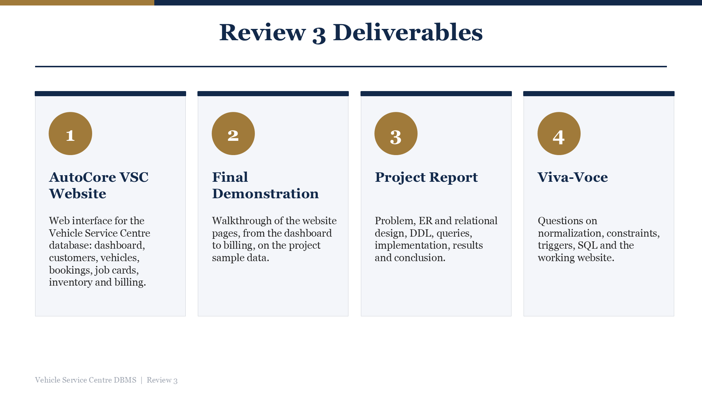

1. **AutoCore VSC Website:** Web interface for the Vehicle Service Centre database featuring the Command Center dashboard, customers, vehicles, service bookings, job cards, inventory, and billing.
2. **Final Demonstration:** Complete end-to-end walkthrough of all website modules, from slot booking to invoice generation and payment.
3. **Project Report:** Comprehensive documentation covering the problem analysis, ER modeling, relational 3NF mapping, DDL, analytical queries, test results, and conclusions.
4. **Viva-Voce:** Defense preparation addressing database normalization, constraint enforcement, SQL queries, triggers, and transactional workflows.

---

## Slide 3: Project Journey: Review 1 to Review 3
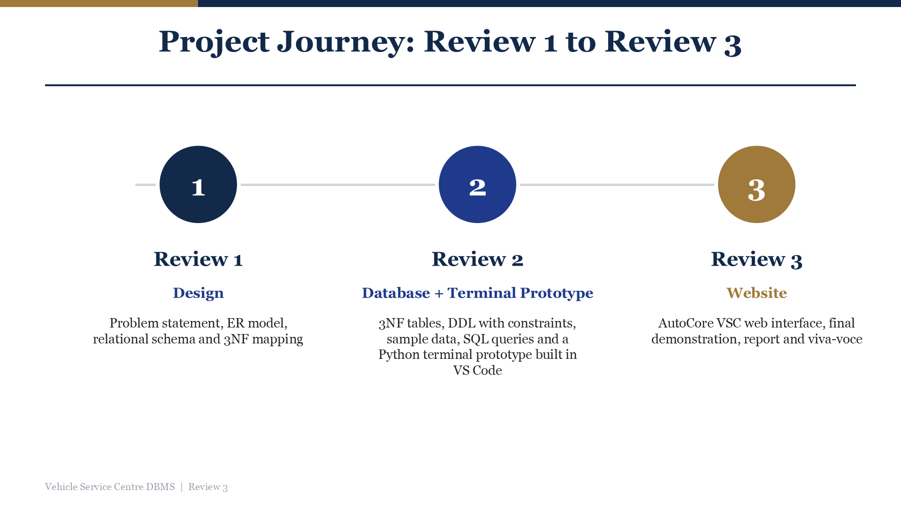

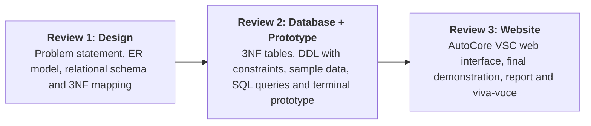

---

## Slide 4: AutoCore VSC: The Website
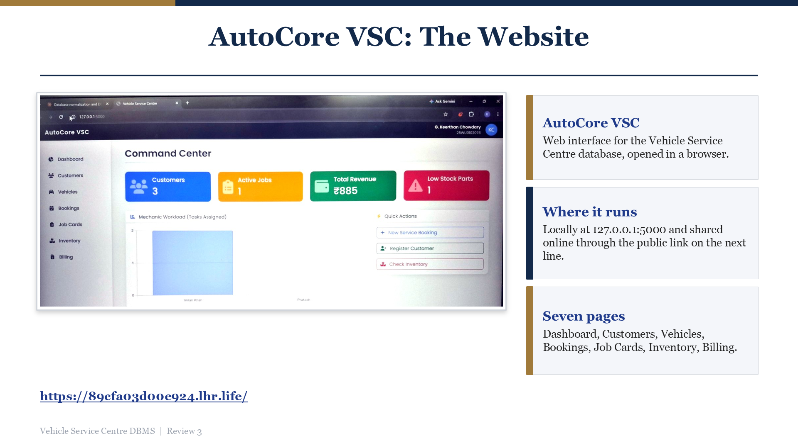

### Deployment & Structure:
- **What it is:** Full-stack web interface for the Vehicle Service Centre database.
- **Where it runs:** Locally at `127.0.0.1:5000` and accessible online via secure tunnel.
- **Seven Dedicated Pages:**
  1. Dashboard (Command Center)
  2. Customers
  3. Vehicles
  4. Bookings
  5. Job Cards
  6. Inventory
  7. Billing & Invoices

---

## Slide 5: Dashboard: Command Center
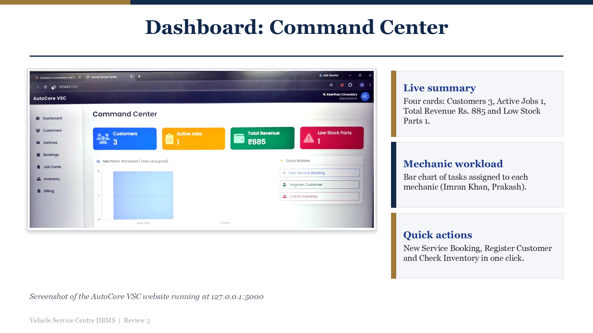

### Dashboard Features:
- **Live Summary Metrics:** Real-time query counts for **Customers (3)**, **Active Jobs (1)**, **Total Revenue (₹885)**, and **Low Stock Parts (1)**.
- **Mechanic Workload Visualizer:** Interactive `Chart.js` bar chart tracking active tasks assigned to mechanics (`Imran Khan`, `Prakash`).
- **Quick Action Center:** One-click shortcuts for *New Service Booking*, *Register Customer*, and *Check Inventory*.

---

## Slide 6: Customers Page
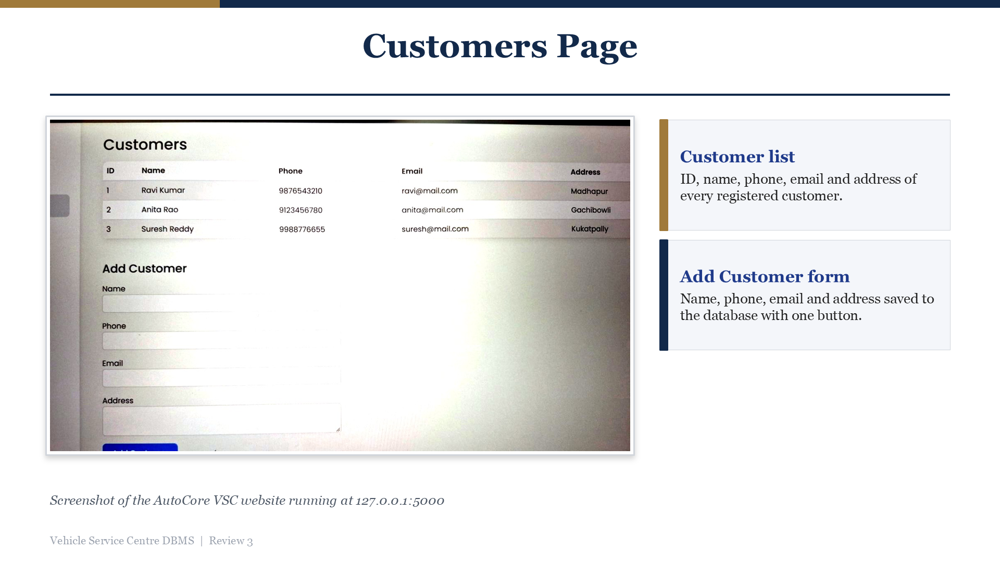

### Key Functionality:
- **Customer Directory:** Tabular listing displaying Customer ID, Name, 10-digit Phone, Email, and Residential Address.
- **Add Customer Form:** Validated input fields enforcing unique phone numbers and email constraints upon submission.

---

## Slide 7: Job Cards Overview
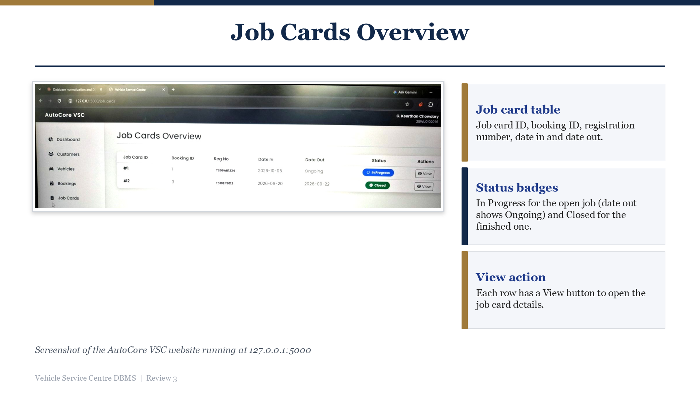

### Tracking Bay Operations:
- **Job Card Table:** Columns for Job Card ID, Booking ID, Registration Number, Check-in Date (`DateIn`), and Completion Date (`DateOut`).
- **Status Badges:** Color-coded badges indicating `In Progress` (blue with loader for active bays) and `Closed` (green checkmark for completed work).
- **View Action:** Per-row action buttons to inspect associated mechanic tasks and parts allocated.

---

## Slide 8: Spare Parts Inventory
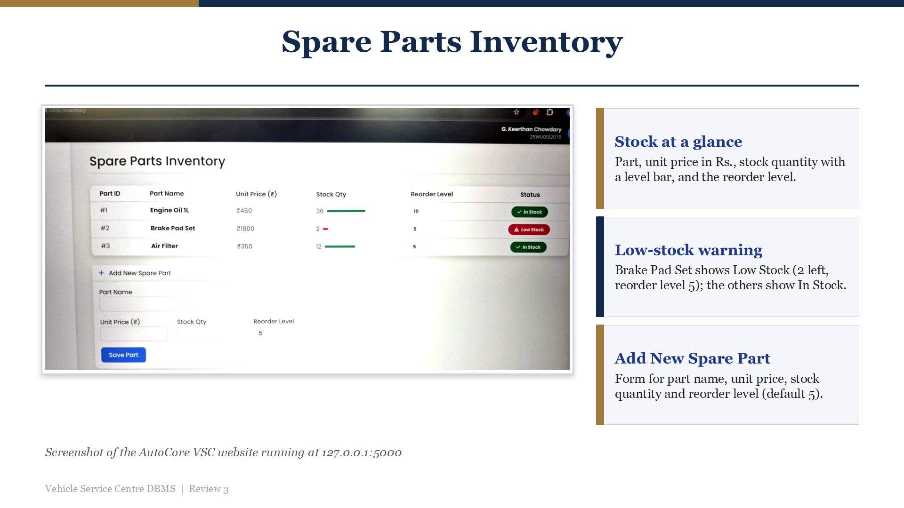

### Real-Time Stock Management:
- **Stock at a Glance:** Part ID, Part Name, Unit Price (₹), Current Stock with dynamic level bar, and Reorder Threshold.
- **Automated Low-Stock Warning:** Visual alert badges (`Low Stock`) triggered automatically when inventory drops to or below the reorder level (e.g., Brake Pad Set at 2 units with threshold of 5).
- **Add New Spare Part Form:** Form allowing inventory controllers to register new stock items, unit costs, and reorder levels.

---

## Slide 9: Billing & Invoices
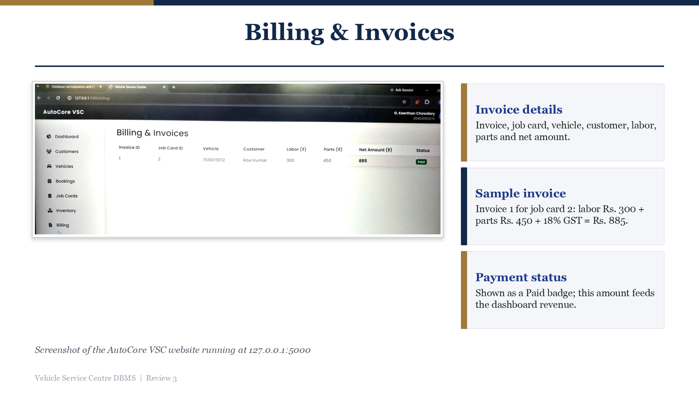

### Consolidated Invoicing:
- **Invoice Summary Table:** Invoice ID, Job Card ID, Vehicle Registration Number, Customer Name, Labor Subtotal, Parts Subtotal, and Net Amount.
- **Sample Invoiced Record:** Invoice 1 for Job Card 2: Labor ₹300 + Parts ₹450 + 18% GST = **₹885.00**.
- **Payment Lifecycle:** Distinct `Paid` and `Unpaid` status badges directly driving dashboard revenue metrics.

---

## Slide 10: End-to-End Workflow
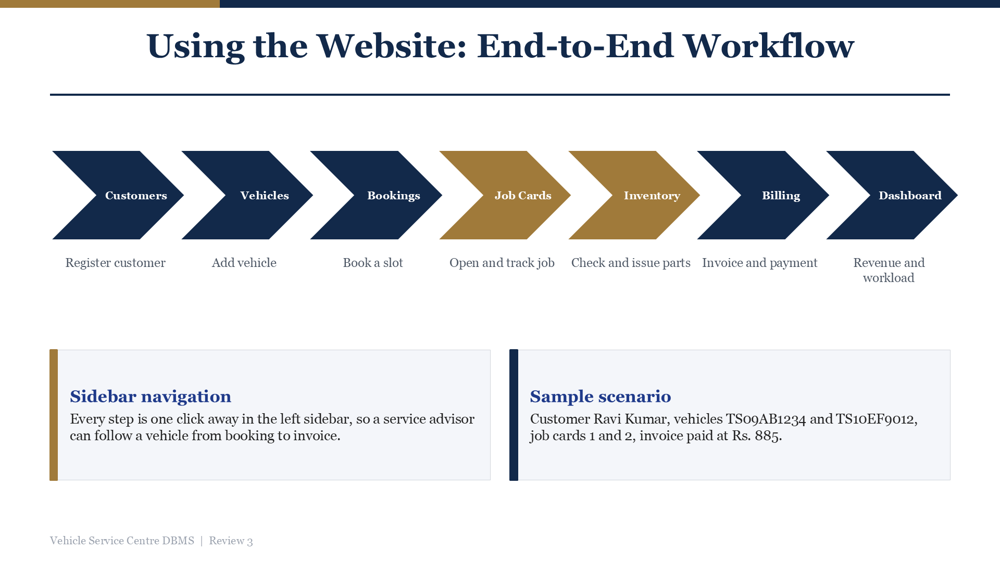

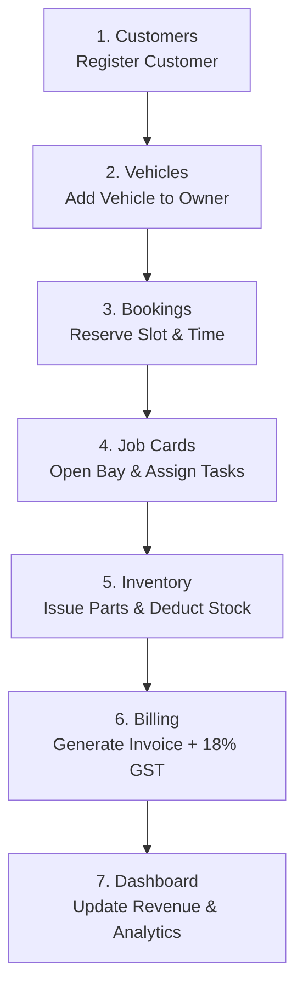

- **Sidebar Navigation:** Every operational module is accessible with one click in the left-hand navigation panel.
- **Sample Scenario:** Customer Ravi Kumar registers vehicle `TS09AB1234`, creates a booking, checks in to generate Job Card 1, receives repair assignments and parts, and receives an itemized invoice.

---

## Slide 11: Architecture: Website & Review 2 Prototype
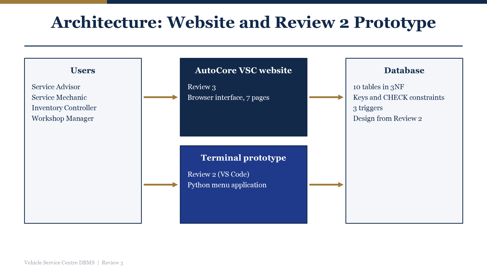

### Architectural Layers:
1. **Users:** Service Advisor, Service Mechanic, Inventory Controller, Workshop Manager.
2. **AutoCore VSC Website (Review 3):** Responsive browser interface across 7 full-stack modules.
3. **Terminal Prototype (Review 2):** Python command-line menu tool for low-overhead administrative access.
4. **Database Engine:** 10 normalized tables in 3NF with declarative primary/foreign keys, `CHECK` constraints, and 3 automated triggers.

---

## Slide 12: Business Rules Enforced by the Database
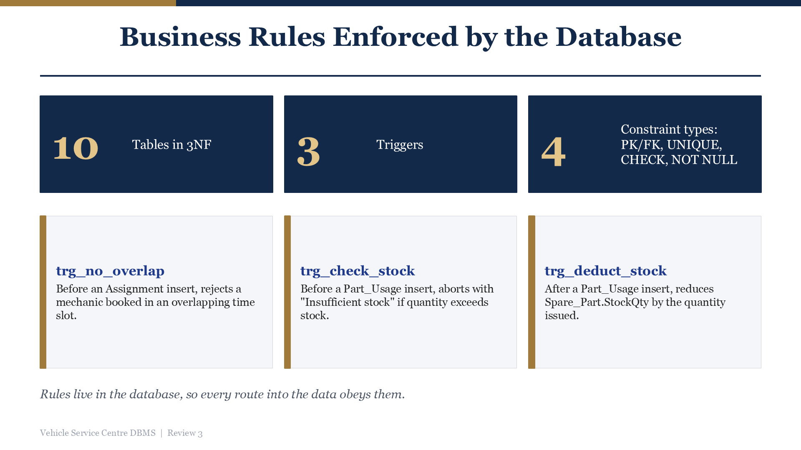

| Rule / Trigger | Type | Enforcement Behavior |
| :--- | :--- | :--- |
| **`trg_no_overlap`** | `BEFORE INSERT ON Assignment` | Rejects any attempt to assign a mechanic to an overlapping time window. |
| **`trg_check_stock`** | `BEFORE INSERT ON Part_Usage` | Aborts transaction with `Insufficient stock` if requested quantity exceeds current stock. |
| **`trg_deduct_stock`** | `AFTER INSERT ON Part_Usage` | Decrements `Spare_Part.StockQty` by the exact quantity issued to the job card. |
| **Declarative Constraints** | `PK, FK, UNIQUE, CHECK` | Prevents duplicate vehicle slot booking, enforces valid fuel types, positive rates, and sequential dates (`DateOut >= DateIn`). |

---

## Slide 13: Testing & Verification Results
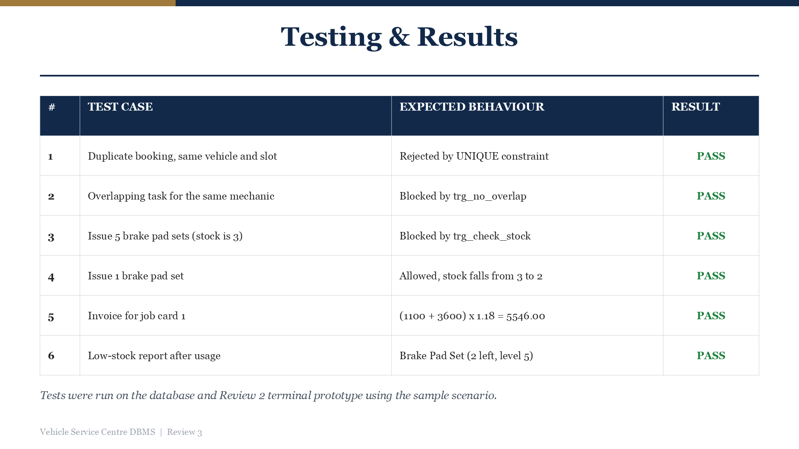

| Test # | Test Scenario | Expected Behavior | Result |
| :---: | :--- | :--- | :---: |
| **1** | Duplicate booking for same vehicle in same slot | Rejected by composite `UNIQUE` constraint | **PASS** |
| **2** | Overlapping task assignment for the same mechanic | Blocked by database trigger `trg_no_overlap` | **PASS** |
| **3** | Issue 5 brake pad sets when available stock is 3 | Blocked by trigger `trg_check_stock` | **PASS** |
| **4** | Issue 1 brake pad set when available stock is 3 | Permitted; stock level decreases from 3 to 2 | **PASS** |
| **5** | Invoice calculation for Job Card 1 | `(1100 + 3600) * 1.18 = ₹5,546.00` | **PASS** |
| **6** | Low-stock notification check | Brake Pad Set flagged as low stock (2 left, threshold 5) | **PASS** |

---

## Slide 14: Conclusion & Future Scope
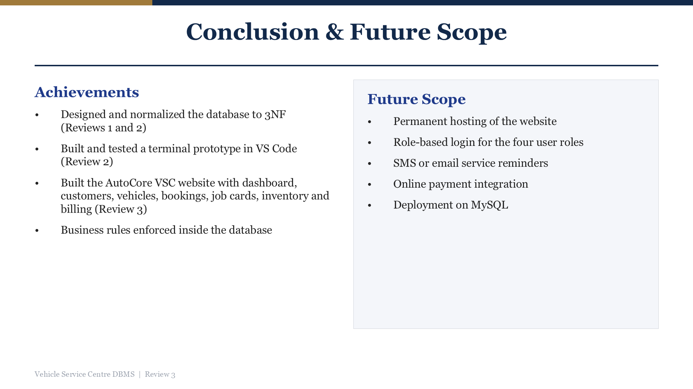

### Key Achievements:
- Designed, normalized, and implemented a robust 10-table 3NF relational database.
- Implemented declarative constraints and automated business triggers directly inside the database engine.
- Built the responsive **AutoCore VSC** web interface with real-time analytics and financial computation.
- Verified system integrity against negative and positive test suites.

### Future Enhancements:
- Cloud database migration to MySQL / PostgreSQL.
- Role-based access control with granular user authentication.
- Automated SMS/WhatsApp notifications for booking confirmations and service updates.
- Integrated payment gateway for online invoice settlements.

---

## Slide 15: Questions & Viva-Voce
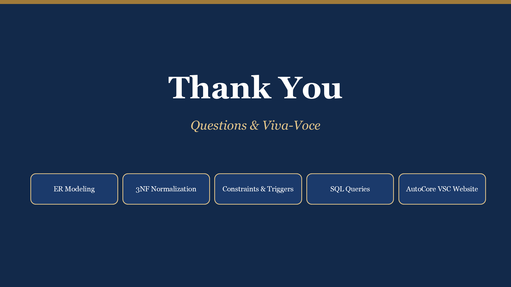

### Viva-Voce Topic Readiness:
- **Conceptual Design:** Entity-Relationship modeling, cardinality resolution, and associative entities.
- **Normalization:** Elimination of insertion, update, and deletion anomalies from UNF to 3NF.
- **Database Integrity:** Difference between declarative `CHECK` constraints and procedural triggers.
- **SQL Competency:** Multi-table joins, subqueries, aggregation, and financial computations.
- **Application Workflow:** End-to-end lifecycle from customer check-in to finalized invoice generation.

---
*End of Review 3 Deliverable*
